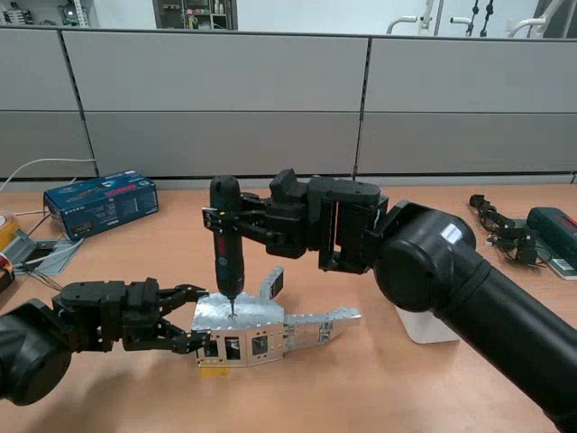
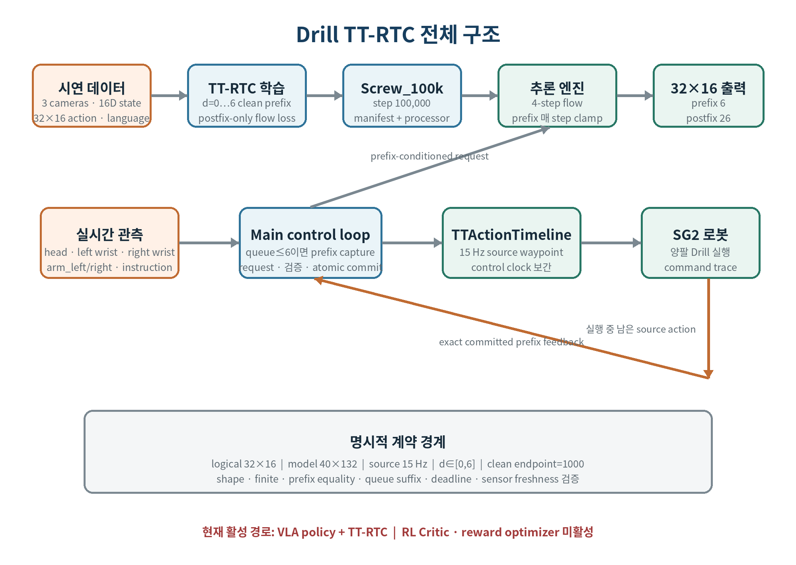
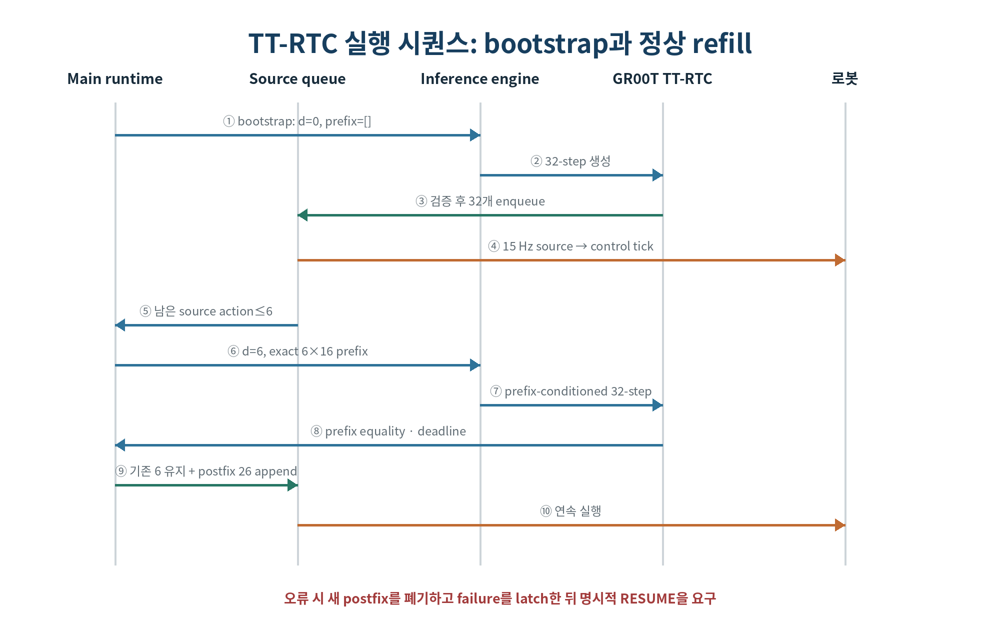
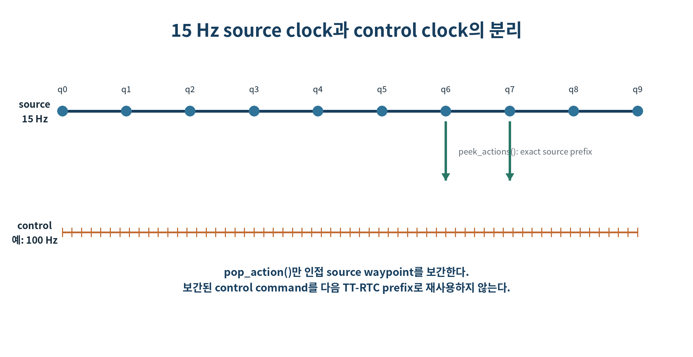
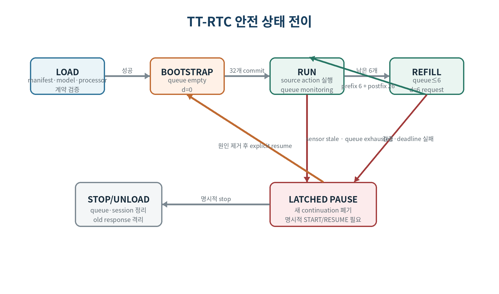
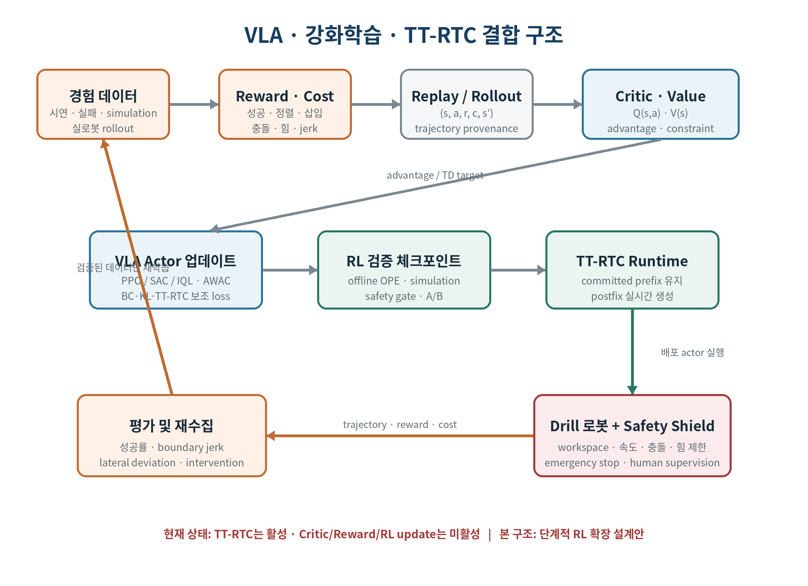
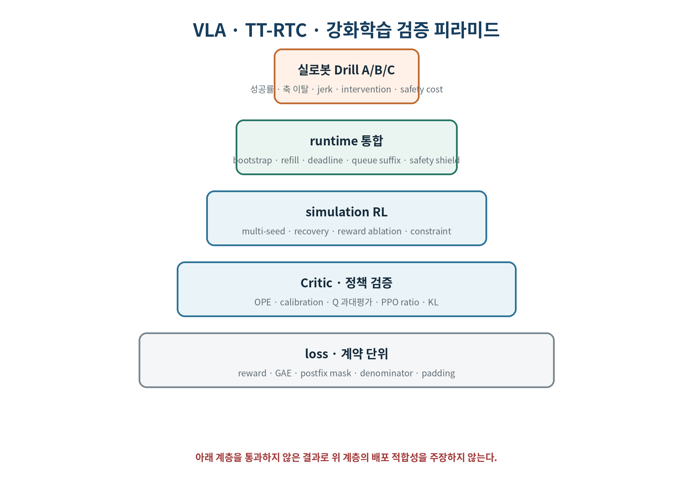

<!-- Math rendering: KaTeX/MathJax-compatible LaTeX -->

# Drill 삽입 작업을 위한 VLA·TT-RTC·강화학습 기술보고서

문서 번호: CYCLO-TR-TTRTC-DRILL-2026-001  
기준일: 2026-10-02  
문서 상태: Final — 현재 TT-RTC 검증 및 강화학습 확장 설계 통합본  
적용 시스템: CYCLO Intelligence / GR00T N1.7 / SG2 양팔 로봇  

> 핵심 판정: 현재 Drill 실행 경로는 **Training-Time Real-Time Chunking(TT-RTC)** 을 사용하며, TT-RTC 자체는 강화학습이 아니다. 그러나 Drill 정책을 시연 재현 수준에서 작업 성공 최적화 단계로 발전시키려면 강화학습이 핵심 확장 축이 된다. 본 문서는 현재 적용된 TT-RTC와 향후 결합할 Actor–Critic 강화학습을 구분하면서 두 구조를 함께 설명한다.

# 초록

본 보고서는 양팔 로봇의 Drill 삽입 작업에서 VLA, TT-RTC, 강화학습이 각각 무엇을 담당하고 어떻게 결합되는지를 설명한다. 현재 체크포인트는 15 Hz에서 32×16 논리 action chunk를 생성하고, 0~6 step의 clean prefix를 조건으로 사용하며, 내부 40×132 텐서에서 postfix-only flow-matching loss를 계산한다. 이 TT-RTC 구조는 추론 지연과 청크 경계 불연속을 줄이지만 작업 성공, 정렬 오차, 삽입 깊이, 접촉 충격을 직접 최적화하지는 않는다. 이를 보완하기 위한 강화학습 장에서는 MDP, reward와 safety cost, Actor–Critic, PPO, SAC, IQL/AWAC, advantage-weighted flow matching의 목적함수와 gradient 의미를 상세히 기술한다. 현재 적용 사실과 향후 설계안을 구분하고, offline 학습에서 simulation과 제한된 실로봇 fine-tuning으로 이어지는 안전한 도입 절차를 제안한다.

# 용어와 표기

| 용어 | 정의 |
|---|---|
| VLA | 영상·언어·로봇 상태로부터 action chunk를 생성하는 Vision-Language-Action 정책 |
| TT-RTC | 학습 시 지연 길이와 clean committed prefix를 주입하여, 실행 중 이미 확정된 동작 다음의 postfix를 생성하는 방식 |
| prefix | 추론이 진행되는 동안에도 실제 실행 큐에 남아 있으며 변경하면 안 되는 확정 동작 |
| postfix | prefix 뒤에 새로 생성되어 실행 큐에 추가되는 동작 |
| logical tensor | 로봇 인터페이스가 의미 있게 사용하는 32×16 action 영역 |
| model tensor | GR00T action head의 고정 최대 크기인 40×132 텐서 |
| source clock | 모델 action waypoint의 시간축. 현재 15 Hz |
| control clock | 로봇 명령을 발행하는 시간축. 15 Hz 이상으로 설정 가능 |
| clean endpoint | flow time τ=1. prefix에 부여되는 시간 상태 |
| bootstrap | 큐가 비어 있는 최초 요청. d=0으로 전체 청크를 생성하는 단계 |
| direct loss | 해당 출력 위치의 오차가 loss 합에 직접 포함되는 항 |
| indirect gradient | prefix 입력이 attention을 통해 postfix 예측에 영향을 주어 전달되는 gradient |
| Actor | 관측에서 행동 또는 action chunk를 생성하는 정책. VLA가 Actor 역할을 수행할 수 있음 |
| Critic | 상태 또는 상태-행동의 장기 누적 보상을 추정하는 V/Q 함수 |
| Advantage | 선택한 행동이 현재 정책의 평균 행동보다 얼마나 유리했는지를 나타내는 값 |
| Reward | 성공률·정렬·삽입 진척처럼 최대화하려는 학습 신호 |
| Safety cost | 충돌·과도한 힘·jerk처럼 제한하거나 최소화해야 하는 위험 신호 |

# 1. 서론

## 1.1 목적

Drill 삽입은 공구 축 정렬, 접근, 체결부 접촉, 삽입 또는 회전, 종료의 연속 단계로 구성된다. 작업 도중 모델 추론이 지연되거나 새 청크가 기존 명령과 불연속이면 드릴 비트가 체결부 중심을 벗어나고 접촉 충격이 커질 수 있다. 본 문서는 TT-RTC가 이 문제를 어떤 데이터와 수식으로 다루고, 코드에서 언제 실행되며, 각 모듈이 어떤 책임을 갖는지를 한 문서에서 추적할 수 있게 하는 것을 목적으로 한다.

## 1.2 범위

문서의 기술 범위는 다음과 같다.

- `Screw_100k` 체크포인트의 TT-RTC 학습 계약과 데이터 계약
- GR00T의 prefix-conditioned flow-matching 원리와 loss
- 강화학습의 MDP, reward, Actor–Critic, PPO·SAC·IQL/AWAC loss
- VLA·강화학습·TT-RTC 결합 구조와 단계별 도입 절차
- 최초 실행, 정상 refill, 응답 검증, queue commit, 제어 주파수 변환의 순서
- Drill 장면과 학습 데이터 메타데이터의 관계
- 일반 VLA 청크 실행 대비 TT-RTC의 이점과 한계
- 단위·통합·실로봇 검증 항목과 합격 기준

Actor, Critic, reward optimization, Q loss, 온라인 강화학습 갱신은 현재 Drill 경로에 활성화되어 있지 않다. 다만 강화학습은 본 보고서의 핵심 설계 대상으로 상세히 다룬다. 저장소에 RLT 관련 공용 코드가 존재하더라도 현재 사용 중이라고 단정하지 않으며, 5장의 모든 RL 항목에는 현재 적용 여부와 도입 조건을 명시한다.

## 1.3 근거 우선순위

사실 충돌 시 다음 순서를 적용한다.

1. 체크포인트의 `tt_rtc_training_manifest.json`, `config.json`, `processor_config.json`
2. 로드·요청·검증·queue commit을 수행하는 실행 코드
3. 테스트 코드와 운영 로그 스키마
4. 설계 문서 및 외부 논문

체크포인트 manifest는 “학습 기록”이며 배포 적합성을 선언하지 않는다. 따라서 `complete=true`는 checkpoint 저장 완료를 의미할 뿐, 실로봇 배포 승인이나 Drill 성공률 달성을 의미하지 않는다.

## 1.4 독자 안내

TT-RTC 원리가 필요하면 2장과 4장을, 강화학습의 원리와 loss가 필요하면 5장을, 실행 시점과 모듈 관계가 필요하면 4.2절과 6장을, 시험 절차가 필요하면 7장을 우선 읽는다. 수식의 모든 기호는 처음 등장하는 곳에서 정의하며, 현재 구현과 향후 RL 설계안을 구분해 표시한다.

# 2. 배경과 문제 정의

## 2.1 일반 VLA action chunk 실행

일반적인 chunk policy는 현재 관측 o_t에서 길이 H의 action sequence를 한 번에 생성한다.

$$
\pi_\theta(o_t,\ell)
\longrightarrow
\mathbf{A}_t
=
\left[
\mathbf{a}_t,
\mathbf{a}_{t+1},
\ldots,
\mathbf{a}_{t+H-1}
\right]
\tag{1}
$$

여기서 o_t는 세 카메라 영상과 로봇 상태, ℓ은 작업 지시문, a_i는 16차원 양팔 action이다. 현재 체크포인트에서 H=32이고 source clock은 15 Hz이므로 한 청크의 논리 시간 폭은 32/15≈2.13 s이다.

이 방식의 장점은 매 제어 tick마다 대형 VLA를 호출하지 않아도 된다는 점이다. 그러나 다음 청크를 계산하는 동안 시간은 계속 흐른다. 새 청크가 계산을 시작한 관측 시점과 실제로 큐에 들어가는 시점 사이에는 센서 취득, 전처리, VLA forward, 응답 전달, 검증 시간이 존재한다. 이 기간에 이미 실행된 action을 무시하고 새 청크의 첫 action부터 실행하면 시간 기준이 어긋난다.

## 2.2 Drill에서 지연이 특히 중요한 이유

자유공간 이동에서는 몇 프레임의 위치 오차가 비교적 완만하게 나타날 수 있다. 반면 Drill 삽입은 다음 이유로 시간 정합에 민감하다.

- 공구 축과 체결부 중심 오차가 접촉 순간 횡방향 힘으로 변환된다.
- 한 팔이 드릴을 들고 다른 팔이 공작물을 지지하는 경우, 양팔 동작의 상대 위상이 중요하다.
- 이전 청크 끝과 새 청크 시작 사이의 관절 위치 점프가 비트 미끄러짐을 유발할 수 있다.
- 추론 지연이 변하면 동일한 새 청크라도 실제 적용 시점이 달라진다.
- 장애나 timeout에서 오래된 continuation을 늦게 넣는 것이 단순히 한 프레임을 건너뛰는 것보다 위험할 수 있다.

## 2.3 TT-RTC의 핵심 아이디어

TT-RTC는 추론 중 이미 실행이 확정된 앞으로의 d개 action을 clean prefix P_t^d로 모델에 다시 제공한다. 모델은 그 prefix를 바꾸지 않고 그 뒤의 continuation을 생성한다.

$$
\mathbf{P}_t^{(d)}
=
\left[
\mathbf{a}_t,
\mathbf{a}_{t+1},
\ldots,
\mathbf{a}_{t+d-1}
\right],
\qquad
d\in\{0,\ldots,6\}
\tag{2}
$$

$$
\pi_\theta\!\left(o_t,\ell,\mathbf{P}_t^{(d)},d\right)
\longrightarrow
\widehat{\mathbf{A}}_t
=
\left[
\mathbf{P}_t^{(d)}
\;\Vert\;
\widehat{\mathbf{a}}_{t+d:t+H-1}
\right]
\tag{3}
$$

핵심은 prefix를 추론 종료 후 한 번 덮어쓰는 것이 아니라, 학습과 추론 모두에서 clean condition으로 표현한다는 점이다. prefix token의 flow time은 clean endpoint이고, postfix token만 noise에서 clean action으로 이동한다.

## 2.4 TT-RTC와 강화학습의 구분

| 항목 | TT-RTC | Actor–Critic 계열 RL |
|---|---|---|
| 최적화 신호 | 시연 action과 noise로 만든 flow velocity target | reward, return, advantage 또는 TD target |
| 주요 loss | postfix-only masked MSE | actor loss, critic/Q loss, entropy/regularization 등 |
| 성공/실패 label의 직접 사용 | 현재 loss에는 없음 | reward 또는 target 구성에 사용 가능 |
| 정책 개선 원리 | 지연 조건에 맞는 시연 continuation 재현 | 누적 보상을 높이는 action 선택 |
| 현재 Drill 활성 경로 | 사용 | 사용하지 않음 |

따라서 현재 checkpoint의 개선 원인을 “RL을 붙였기 때문”이라고 설명하면 사실과 다르다. 현재 효과는 TT-RTC의 지연 조건화와 청크 연속성에서 나온다. 다만 강화학습을 결합하면 reward를 통해 작업 성공과 실패 복구를 직접 최적화할 수 있으며, 그 원리와 loss, 도입 조건은 5장에서 별도의 핵심 구조로 설명한다.

## 2.5 이론적 한계

TT-RTC는 시간 정합을 개선하지만 다음을 자동 해결하지 않는다.

- 카메라 가림이나 잘못된 task instruction
- 시연 데이터에 없는 체결부 형상과 공구 반력
- force/torque 센서가 입력에 없을 때의 접촉력 직접 제어
- 잘못 라벨링된 시연, 편향된 종료 프레임, 과도한 repeat-last padding
- 로봇 기구학·캘리브레이션 오차
- 추론 시간이 prefix 실행 가능 시간보다 길 때의 deadline 위반

# 3. Drill 작업과 체크포인트 분석

## 3.1 실제 Drill 삽입 장면



그림 1 — `Task_900003_1002_Drill_Into_Screw_MCAP_human_lerobot_v21`의 episode 0, head camera frame 184(약 12.27 s). 오른팔이 드릴을 수직에 가깝게 유지하고 왼팔이 대상물을 지지하는 구간이다.

이 장면은 실제 작업 맥락을 확인하기 위한 원천 데이터 프레임이다. 모델 manifest의 `train` 데이터셋과 프레임 수가 다르므로, 동일한 학습 split이라고 단정하지 않는다. 보고서에서 장면의 시각적 관찰과 학습 계약을 분리한 이유다.

## 3.2 데이터 아티팩트 구분

| 구분 | 경로/식별자 | 확인 값 | 해석 |
|---|---|---|---|
| 장면 확인용 LeRobot v2.1 | `Task_900003_1002_Drill_Into_Screw_MCAP_human_lerobot_v21` | 13 episodes, 4,937 frames, 15 Hz | 그림 1의 출처 |
| 체크포인트 학습 manifest | `Screw_100k/experiment_cfg/tt_rtc_training_manifest.json` | 12 episodes, 6,079 frames, 15 Hz | TT-RTC 학습 계약의 근거 |
| 체크포인트 | `Screw_100k` | step 100,000, complete | 저장 완료 상태. 배포 적합성은 별도 |

서로 다른 episode/frame 수는 오류라고 단정할 수 없다. 편집, 변환, train split 구성 또는 다른 export의 결과일 수 있다. 재현 실험에서는 dataset URI와 전체 콘텐츠 digest를 추가로 고정해야 한다. 현재 manifest의 fingerprint 범위는 `info.json`에 한정된다.

## 3.3 입력과 출력 modality

현재 체크포인트의 논리 입력·출력은 다음과 같다.

| 분류 | 구성 | 차원/개수 |
|---|---|---|
| 영상 | `cam_left_head`, `cam_left_wrist`, `cam_right_wrist` | 3 streams, 현재 프레임 |
| 상태 | `arm_left`, `arm_right` | 8+8=16 |
| 언어 | `annotation.human.task_description` | 1 instruction |
| action | `arm_left`, `arm_right` | 8+8=16 |
| 논리 horizon | delta index 0…31 | 32 steps |
| source rate | action waypoint clock | 15 Hz |

16차원 action은 좌·우 팔 각각 7개 관절과 gripper 1개로 해석되는 양팔 action group이다. 이 체크포인트는 head, lift, mobile command를 action output으로 포함하지 않는다. 따라서 다른 19D 또는 22D 프로파일의 상수와 혼용하면 안 된다.

## 3.4 논리 텐서와 모델 텐서

사용자에게 의미 있는 action은 32×16이지만 GR00T action head의 최대 규격은 40×132이다.

| 영역 | 시간축 | 차원축 | loss 포함 |
|---|---:|---:|---|
| 논리 action | 0…31 | 0…15 | valid postfix만 포함 |
| 시간 padding | 32…39 | 전체 | 제외 |
| 차원 padding | 전체 | 16…131 | 제외 |
| committed prefix | 0…d−1 | 0…15 | direct loss 제외, condition으로 사용 |

valid mask 없이 전체 40×132에 평균을 내면 padding이 loss 분모를 오염시킨다. prefix를 분모에 남기고 분자만 0으로 만드는 구현도 loss scale을 d에 따라 바꾸므로 잘못이다. 정확한 분모는 valid postfix component 수다.

## 3.5 episode 끝 padding 정책

manifest는 모든 start frame을 학습 표본으로 포함하고, horizon 밖 action은 마지막 action을 반복하여 채운다. 반복된 action도 postfix loss에 포함된다. 이는 종료 자세를 유지하는 분포를 학습하는 데 도움이 될 수 있지만, 긴 정지 tail이 과대표현되면 움직임 종료를 지나치게 선호할 수 있다. 검증 시 실제 motion 구간과 padded tail 구간의 loss를 분리해서 확인해야 한다.

# 4. TT-RTC 설계와 알고리즘

## 4.1 전체 구조



그림 2 — 데이터·학습·체크포인트·실시간 실행의 전체 구조. 현재 VLA policy와 TT-RTC는 활성 상태이며 RL Critic과 reward optimizer는 비활성 상태다.

전체 흐름은 “시연 데이터 → TT-RTC flow fine-tuning → 계약이 포함된 checkpoint → prefix-conditioned inference → source queue → control clock 변환 → 로봇”이다. 각 경계에서 shape, 시간축, 값의 domain을 명시적으로 검증한다.

## 4.2 실행 시점



그림 3 — bootstrap과 정상 refill의 실행 순서. 기본 prefix 모드는 `fixed_first_6`, temporal overlap 기본값은 0이다.

### 4.2.1 최초 bootstrap

1. 정책을 로드할 때 checkpoint manifest와 실제 모델/processor 계약을 교차 검증한다.
2. 실행 큐가 비어 있으면 `d=0`, 빈 prefix로 안전한 최초 요청을 보낸다.
3. VLA는 32개 action을 반환한다.
4. 형상, 유한값, horizon, action dimension, deadline 검사를 통과하면 32개를 source queue에 넣는다.

### 4.2.2 정상 refill

1. `TTActionTimeline`의 남은 source action 수가 6 이하가 되면 다음 요청을 시작한다.
2. `peek_actions(count=6)`으로 아직 실행되지 않은 정확한 action 6개를 복사한다.
3. 이 6×16 physical prefix와 `d=6`을 inference engine에 보낸다.
4. 모델은 prefix를 유지한 32×16 청크를 반환한다.
5. 런타임은 반환된 처음 6개가 보낸 prefix와 일치하는지 검사한다.
6. 이미 큐에 있는 prefix는 그대로 두고 `chunk[6:]`, 즉 26개 postfix만 append한다.
7. 결과적으로 source queue는 다시 최대 32개 waypoint를 갖는다.

15 Hz에서 d=6은 약 0.4 s의 확정 실행 구간이며 postfix 26개는 약 1.73 s다. 단, 구현의 timeout budget은 학습 d로부터 자동 계산하지 않고 requester의 별도 timeout(기본 5 s)을 사용한다. 그러므로 0.4 s를 넘긴 응답이 물리적으로 항상 안전하다고 해석하면 안 되며, 실제 latency·buffer exhaustion·pause 동작을 함께 시험해야 한다.

### 4.2.3 실패 시점

다음 조건에서는 새 continuation을 사용하지 않고 TT-RTC failure를 latch하여 명령 생성을 정지하고 명시적 START/RESUME을 요구한다.

- 요청 prefix의 shape 또는 유한값 오류
- `d`가 bootstrap 0 또는 학습 범위 0…6을 벗어남
- 응답 horizon/dimension 불일치
- 반환 prefix와 committed prefix 불일치
- 추론 중 큐 내용이 캡처한 suffix와 다르게 변함
- capture-to-enqueue deadline 초과
- 모델 checkpoint·processor·manifest 계약 불일치
- 큐가 비정상적으로 소진되어 정상 요청에서 d=0이 됨
- 실로봇 관측 freshness 검증 실패

## 4.3 학습 표본 구성

한 표본의 clean action을 a∈R^(H×D), 독립 Gaussian noise를 ε∈R^(H×D)라 한다. 현재 H=32, D=16이다. 내부 패딩 뒤에는 40×132가 되지만 다음 수식은 logical valid 영역을 기준으로 쓴다.

표준 flow path는 noise endpoint τ=0에서 clean endpoint τ=1로 선형 이동한다.

$$
\mathbf{x}_i(\tau)
=
(1-\tau)\boldsymbol{\varepsilon}_i
+
\tau\mathbf{a}_i,
\qquad
\tau\in[0,1]
\tag{4}
$$

이 경로의 시간 미분은 일정하다.

$$
\mathbf{u}_i^*
=
\frac{\partial\mathbf{x}_i(\tau)}{\partial\tau}
=
\mathbf{a}_i-\boldsymbol{\varepsilon}_i
\tag{5}
$$

모델 v_θ는 관측 o, 언어 ℓ, noisy/clean-mixed action x, token별 time code를 보고 target velocity u*를 예측한다.

## 4.4 delay sampling과 prefix mask

학습 때 각 표본마다 정수 delay d를 균등하게 뽑는다.

$$
\begin{aligned}
d
&\sim
\operatorname{UniformInteger}\!\left\{0,1,2,3,4,5,6\right\},\\[2pt]
\Pr(d=k)
&=
\frac{1}{7},
\qquad k\in\{0,\ldots,6\}
\end{aligned}
\tag{6}
$$

prefix mask p_i와 valid component mask m_ij를 정의한다.

$$
\begin{aligned}
p_i
&=
\mathbf{1}\!\left\{i<d\right\},\\[2pt]
m_{ij}
&=
\mathbf{1}\!\left\{i<H\;\land\;j<D\;\land\;\mathrm{dataset\text{-}valid}_{ij}\right\}
\end{aligned}
\tag{7}
$$

prefix는 ground-truth clean action으로 대체하고 postfix만 flow corruption을 적용한다.

$$
\widetilde{\mathbf{x}}_i
=
\begin{cases}
\mathbf{a}_i,
& i<d,\\[2pt]
(1-\tau)\boldsymbol{\varepsilon}_i+\tau\mathbf{a}_i,
& i\ge d
\end{cases}
\tag{8}
$$

action token time도 위치별로 다르다.

$$
\widetilde{\tau}_i
=
\begin{cases}
1, & i<d,\\[2pt]
\tau, & i\ge d
\end{cases}
\tag{9}
$$

time bucket 수 K=1000일 때 postfix code는 floor(τK), prefix code는 clean endpoint code K=1000이다. state token time은 sampled flow time τ를 사용한다. 즉 action prefix만 clean endpoint이며, state를 τ=1로 잘못 고정하지 않는다.

## 4.5 핵심 loss: postfix-only masked flow matching

### 4.5.1 정의

잔차 $r_{bij}(\theta)$와 유효 postfix 가중치 $w_{bij}$를 먼저 정의하면, batch $B$에 대한 현재 목적함수를 다음처럼 읽기 쉽게 쓸 수 있다.

$$
\begin{aligned}
r_{b i j}(\theta)
&=
v_\theta\!\left(
\widetilde{\mathbf{x}},
\widetilde{\boldsymbol{\tau}},
o,
\ell
\right)_{b i j}
-
\left(a_{b i j}-\varepsilon_{b i j}\right),\\[4pt]
w_{b i j}
&=
m_{b i j}\left(1-p_{b i}\right),\\[4pt]
Z
&=
\sum_{b,i,j}w_{b i j},\\[4pt]
\mathcal{L}_{\mathrm{TT\text{-}RTC}}(\theta)
&=
\frac{1}{Z}
\sum_{b,i,j}w_{b i j}\,r_{b i j}(\theta)^2
\end{aligned}
\tag{10}
$$

분자는 valid postfix residual의 제곱합이고, 분모는 동일한 valid postfix component 수다. `postfix_only`는 단순히 prefix target을 0으로 바꾼다는 뜻이 아니다. prefix 위치는 분자와 분모 모두에서 제외해야 한다.

### 4.5.2 원리

prefix는 이미 실행이 확정된 action이므로 모델이 그것을 새로 예측하여 수정할 이유가 없다. 오히려 학습 목표는 “이 clean history가 주어졌을 때 그 다음 action을 생성하는 방법”이다. 따라서 prefix는 조건 입력이고 postfix만 예측 목표다.

d=0이면 모든 32개 위치가 postfix이므로 식 (10)은 valid 영역의 표준 flow-matching MSE와 동일하다. d=6이면 앞 6개는 direct loss에서 제외되고 뒤 26개만 loss를 만든다. 이는 manifest의 `min_postfix_steps=26`과 일치한다.

### 4.5.3 gradient 해석

$Z=\sum m(1-p)$라 하면 각 출력 잔차에 대한 미분은 다음과 같다.

$$
\frac{\partial\mathcal{L}}{\partial v_{b i j}}
=
\frac{2m_{b i j}(1-p_{b i})}{Z}
\left[
v_{b i j}-u^*_{b i j}
\right]
\tag{11}
$$

i<d인 prefix 출력에는 (1−p)=0이므로 direct gradient가 0이다. 그러나 prefix **입력 token**은 attention에서 postfix token의 표현에 영향을 준다. 따라서 postfix loss의 chain rule을 통해 prefix 정보 사용법은 학습된다.

$$
\frac{\partial\mathcal{L}}{\partial\mathbf{h}^{\mathrm{prefix}}}
=
\sum_{i\ge d}
\frac{\partial\mathcal{L}}{\partial\mathbf{v}_i}
\frac{\partial\mathbf{v}_i}{\partial\mathbf{h}^{\mathrm{prefix}}}
\tag{12}
$$

“prefix loss가 없다”와 “prefix를 detach한다”는 전혀 다르다. 후자는 모델이 prefix를 continuation 조건으로 활용하는 경로를 약화하거나 차단할 수 있다.

### 4.5.4 분모와 loss scale

표본 b의 valid postfix component 수는 대략 (H−d_b)D다. batch 전체 valid component로 나누면 delay 조합이 달라도 component당 평균 residual의 의미가 유지된다.

$$
\begin{aligned}
Z
&=
\sum_{b,i,j}m_{b i j}(1-p_{b i}),\\[2pt]
Z
&=
\sum_b(H-d_b)D
\qquad
\text{(패딩이나 결측 마스크가 없을 때)}
\end{aligned}
\tag{13}
$$

prefix를 분자에서만 제거하고 분모를 HD로 유지하면 d가 클수록 loss가 인위적으로 작아진다. 이는 optimizer가 delay별 난이도가 아니라 mask 크기에 반응하게 만든다.

### 4.5.5 위치별 supervision 빈도

d가 0…6에서 균등할 때 논리 위치 i가 postfix로 직접 학습될 확률은 다음과 같다.

$$
\Pr\!\left(i\ \text{is supervised}\right)
=
\Pr(d\le i)
=
\begin{cases}
\dfrac{i+1}{7}, & 0\le i\le6,\\[6pt]
1, & i>6
\end{cases}
\tag{14}
$$

따라서 i=0은 1/7, i=1은 2/7, …, i≥6은 1의 확률로 direct loss에 포함된다. 이것은 설계상 자연스러운 결과지만, 초반 위치 성능이 중요한 경우 delay-stratified metric을 따로 기록해야 한다.

### 4.5.6 padding의 영향

내부 40×132 텐서에서 logical 32×16 밖은 반드시 m=0이어야 한다. episode 끝에서 repeat-last로 만들어진 logical action은 manifest 정책상 m=1이며 loss에 포함된다. “모델 padding”과 “dataset의 repeat-last target”은 둘 다 값이 반복되거나 0일 수 있지만 의미가 다르므로 같은 mask로 제거해서는 안 된다.

## 4.6 학습 알고리즘 의사코드

```text
for batch in dataloader:
    a, valid = preprocess_and_pad(batch.actions)       # [B, 40, 132]
    ε = randn_like(a)
    τ = sample_flow_time(B)                            # [B]
    d = sample_uniform_integer(0, 6, B)               # [B]

    prefix[b,i] = (i < d[b])
    τ_action[b,i] = 1.0 if prefix[b,i] else τ[b]
    x = (1 - τ) * ε + τ * a
    x[prefix] = a[prefix]                              # exact clean condition

    target = a - ε
    prediction = model(observation, language, x,
                       state_time=τ,
                       action_time=τ_action)

    postfix_valid = valid AND NOT prefix
    loss = sum(postfix_valid * (prediction-target)^2) \
           / sum(postfix_valid)
    optimizer.zero_grad()
    loss.backward()
    optimizer.step()
```

구현 검증에서는 `sum(postfix_valid)>0`을 확인해야 한다. 현재 H=32, max d=6이므로 정상 계약에서는 최소 26×16개의 logical component가 남아 0이 될 수 없다.

## 4.7 추론 알고리즘

추론 시작 시 postfix는 Gaussian noise로 초기화하고 prefix는 정규화된 committed action으로 채운다. 현재 inference step 수는 $N=4$이므로 $\Delta\tau=1/4$이다.

$$
\begin{aligned}
\mathbf{x}^{(0)}_{\mathrm{postfix}}
&\sim
\mathcal{N}(\mathbf{0},\mathbf{I}),\\[2pt]
\mathbf{x}^{(0)}_{\mathrm{prefix}}
&=
\mathbf{P}_t^{(d)}
\end{aligned}
\tag{15}
$$

각 Euler step k에서 postfix를 적분한다.

$$
\begin{aligned}
\Delta\tau
&=
\frac{1}{N}
=
\frac{1}{4},\\[3pt]
\mathbf{x}^{(k+1)}_{\mathrm{postfix}}
&=
\mathbf{x}^{(k)}_{\mathrm{postfix}}
+
\Delta\tau\,
\mathbf{v}_\theta\!\left(
\mathbf{x}^{(k)},
\tau_k,
o,
\ell
\right)_{\mathrm{postfix}}
\end{aligned}
\tag{16}
$$

prefix는 네트워크 호출 전과 update 후 모두 재고정한다.

$$
\mathbf{x}^{(k)}_{\mathrm{prefix}}
\leftarrow
\mathbf{P}_t^{(d)},
\qquad
\mathbf{x}^{(k+1)}_{\mathrm{prefix}}
\leftarrow
\mathbf{P}_t^{(d)}
\tag{17}
$$

마지막에만 prefix를 덮어쓰는 방식은 중간 네트워크 호출이 손상된 prefix를 조건으로 사용하게 하므로 TT-RTC 의미를 보장하지 못한다. 현재 patch는 매 step에서 prefix token time을 1000으로 설정하고 prefix를 적분하지 않는다.

## 4.8 물리 action domain과 정규화

실행 큐의 prefix는 로봇에 실제 발행될 physical action이다. inference engine은 이를 checkpoint processor로 한 번만 normalize하고 132차원으로 pad한다. 이때 `clip_outliers=False`를 사용하여 decode→physical execution→re-normalize 과정의 가역성을 보존한다. 결과를 physical domain으로 decode한 뒤 반환 prefix가 원래 physical prefix와 허용오차 내에서 일치하는지 다시 검사한다.

동일 prefix를 이미 normalized된 값으로 오해해 두 번 normalize하거나, control clock에서 보간된 중간 명령을 source prefix로 다시 넣으면 학습 계약과 달라진다. `peek_actions()`는 source queue의 정확한 waypoint를 제공하고 `pop_action()`만 control clock 보간을 수행한다.

## 4.9 source clock과 control clock



그림 4 — 15 Hz source waypoint와 더 빠른 control tick의 관계. prefix에는 보간 출력이 아니라 아직 소비되지 않은 source waypoint를 사용한다.

TTActionTimeline은 정수 phase accumulator를 사용해 비정수 비율에서도 장기 drift를 피한다. 예를 들어 control_hz=100이면 매 0.01 s마다 보간 명령을 만들되, source waypoint는 정확히 1/15 s의 시간 기준으로 진행한다.

$$
\begin{aligned}
\mathbf{q}(t)
&=
(1-\alpha)\mathbf{q}_k
+
\alpha\mathbf{q}_{k+1},\\[3pt]
\alpha
&=
\frac{t-t_k}{t_{k+1}-t_k},
\qquad
\alpha\in[0,1]
\end{aligned}
\tag{18}
$$

식 (18)의 q(t)는 로봇 발행용이다. 다음 TT-RTC 조건은 q(t)가 아니라 q_k, q_{k+1}, …의 정확한 source action이다.

## 4.10 시간·연속성 invariant

정상 commit이 만족해야 하는 핵심 불변조건은 다음과 같다.

$$
\widehat{\mathbf{A}}_t[0{:}d]
=
\mathbf{P}_t^{(d)}
\tag{19}
$$

$$
\mathbf{Q}_{\mathrm{after}}
=
\mathbf{Q}_{\mathrm{remaining\ prefix}}
\;\Vert\;
\widehat{\mathbf{A}}_t[d{:}H]
\tag{20}
$$

여기서 ∥는 시간축 연결이다. 큐가 캡처 이후 정상적으로 prefix 앞부분만 소비되었다면 현재 큐는 캡처 큐의 정확한 suffix여야 한다. 다른 값이 삽입되거나 순서가 바뀌면 응답을 폐기한다.

## 4.11 안전 상태 전이



그림 5 — load, bootstrap, run, refill, latched pause, explicit resume의 상태 전이.

오래된 응답을 억지로 적용하기보다 failure를 latch하는 이유는 Drill 접촉 구간에서 시간축이 틀어진 continuation이 명시적 정지보다 위험할 수 있기 때문이다. 실패 후에는 queue와 상태를 정리하고, 운영자가 원인을 확인한 뒤 명시적으로 재시작해야 한다.

# 5. 강화학습 핵심 원리와 Drill 결합 설계

> **적용 상태:** 이 장의 강화학습 구조는 Drill 시스템의 핵심 확장 설계다. 다만 현재 `Screw_100k` 체크포인트에서 확인된 학습은 TT-RTC flow matching이며, Critic, reward optimizer, PPO/SAC update는 아직 활성 구성으로 확인되지 않았다. 따라서 아래 수식은 “현재 동작을 설명하는 식”과 “도입할 RL 학습 식”을 명확히 구분한다.

## 5.1 VLA와 TT-RTC만으로 부족한 부분

VLA의 시연 학습은 데이터에 있는 행동을 재현하는 데 강하다. 그러나 성공 시연만 모방하면 드릴 축이 조금 틀어졌을 때 어떻게 복구해야 하는지, 속도를 얼마나 줄여야 접촉 충격이 감소하는지, 성공률과 작업 시간을 어떤 비율로 절충해야 하는지를 직접 학습하기 어렵다. TT-RTC는 시간 지연과 청크 경계를 다루지만, 어떤 continuation이 더 성공적인지를 reward로 비교하지 않는다.

강화학습은 상호작용 결과를 reward와 cost로 바꾸고, 장기 누적 성과가 높은 행동의 확률을 높인다. 따라서 세 구성요소의 책임은 다음처럼 구분해야 한다.

| 구성요소 | 직접 해결하는 문제 | 학습 신호 | Drill에서의 역할 |
|---|---|---|---|
| VLA 시연 학습 | 영상·언어·상태에서 기본 행동 생성 | expert action | 접근·파지·정렬·삽입의 기본 동작 확보 |
| TT-RTC | 추론 지연과 청크 경계 불연속 | clean prefix + postfix flow target | 실행 중 확정된 동작을 보존하고 자연스럽게 이어서 생성 |
| 강화학습 | 성공률·복구·효율·안전의 장기 최적화 | reward, return, advantage, safety cost | 실패 복구, 정렬 정밀도, 작업 시간과 충격의 절충 학습 |

RL은 VLA를 폐기하는 별도 제어기가 아니라, 이미 학습된 VLA를 Actor의 초기값 또는 기준 정책으로 사용해 “더 좋은 행동” 쪽으로 제한적으로 이동시키는 층으로 보는 것이 안전하다.

## 5.2 VLA·강화학습·TT-RTC 전체 구조



그림 6 — 시연과 rollout에서 reward·cost를 계산하고 Critic과 VLA Actor를 갱신한 뒤, 검증된 Actor를 TT-RTC runtime으로 실행하는 확장 구조. 붉은 문구는 현재 RL update가 비활성이라는 사실을 나타낸다.

학습 측에서는 trajectory를 수집하고 reward와 safety cost를 붙인 뒤 Actor와 Critic을 갱신한다. 실행 측에서는 검증을 마친 Actor만 로드하며, TT-RTC가 committed prefix를 유지한 상태로 postfix를 생성한다. Critic은 보통 학습 때만 사용하므로 제어 주기마다 반드시 실행할 필요는 없다. 반면 safety shield, workspace 제한, 속도 제한, emergency stop은 학습 여부와 관계없이 runtime에 남아야 한다.

## 5.3 MDP와 action chunk 정의

강화학습 문제는 Markov Decision Process(MDP)로 정의한다.

$$
\mathcal{M}
=
\left(
\mathcal{S},
\mathcal{A},
P,
r,
\gamma
\right)
\tag{21}
$$

- 상태 $s_t\in\mathcal{S}$는 세 카메라 영상, 양팔 관절 상태, 작업 지시, 필요하면 직전 action과 TT-RTC prefix를 포함한다.
- 행동 $a_t\in\mathcal{A}$는 한 control action 또는 길이 $H$의 action chunk다. 현재 논리 chunk는 $H=32$, action dimension은 $D=16$이다.
- 전이 $P(s_{t+1}\mid s_t,a_t)$는 로봇과 공구, 체결부, 접촉 동역학을 포함한다.
- reward $r_t$는 성공과 진척을 보상하고 위험한 접촉과 불연속을 벌점으로 준다.
- 할인율 $\gamma\in[0,1)$는 즉시 성과와 장기 성과의 상대적 중요도를 정한다.

정책이 최대화하려는 discounted return은 다음과 같다.

$$
G_t
=
\sum_{k=0}^{T-t-1}
\gamma^k r_{t+k}
\tag{22}
$$

$\gamma$가 너무 작으면 당장의 삽입 진척만 보고 후속 충돌을 무시할 수 있다. 반대로 지나치게 크면 긴 horizon의 value 추정 분산이 커진다. Drill에서는 접근, 정렬, 접촉, 체결 완료가 한 episode 안에서 연결되므로 phase별 reward와 terminal success를 함께 사용해야 한다.

## 5.4 Reward와 safety cost 설계

### 5.4.1 보상 함수

Drill reward는 단일 성공 신호만 두기보다, 성공을 중심으로 정렬·진척·안정성·효율을 보조 신호로 구성하는 편이 학습하기 쉽다.

$$
\begin{aligned}
r_t
={}&
w_{\mathrm{succ}}r_t^{\mathrm{succ}}
+
w_{\mathrm{prog}}r_t^{\mathrm{progress}}
+
w_{\mathrm{align}}r_t^{\mathrm{align}}\\[2pt]
&-
w_{\mathrm{force}}c_t^{\mathrm{force}}
-
w_{\mathrm{jerk}}c_t^{\mathrm{jerk}}
-
w_{\mathrm{coll}}c_t^{\mathrm{collision}}
-
w_{\mathrm{time}}c_t^{\mathrm{time}}
\end{aligned}
\tag{23}
$$

| 항목 | 예시 정의 | 의도 | 주의점 |
|---|---|---|---|
| 성공 보상 | 목표 깊이·회전·체결 조건 충족 시 큰 terminal reward | 최종 작업 성공을 최우선으로 둠 | 판정 센서와 허용오차를 명시해야 함 |
| 진척 보상 | 직전 step 대비 삽입 깊이 증가량 | sparse reward의 학습 지연 완화 | 비정상적으로 밀어 넣는 행동을 성공으로 오인하지 않게 제한 |
| 정렬 보상 | 축 각도·중심 오차의 감소량 | 비트와 체결부 축 정렬 | 영상 추정 오차와 calibration drift 관리 |
| 힘 cost | 허용 범위를 넘는 축·횡방향 힘 | 대상물·공구 보호 | force/torque 센서가 없으면 직접 항으로 사용할 수 없음 |
| jerk cost | 관절 또는 Cartesian jerk | 청크 경계 충격과 진동 억제 | 지나치면 필요한 빠른 복구도 억제함 |
| 충돌 cost | self/environment collision 또는 금지 영역 진입 | 안전 보장 | reward 상쇄가 아니라 별도 hard constraint가 필요함 |
| 시간 cost | step당 작은 음의 값 | 불필요하게 느린 정책 방지 | 성공 보상보다 커지지 않도록 scale 관리 |

보상 항의 단위가 서로 다르므로 정규화가 필요하다. 예를 들어 거리 m, 각도 rad, 힘 N, jerk rad/s³를 그대로 더하면 수치 크기가 큰 항이 학습을 지배한다. 각 항을 허용 범위 또는 robust scale로 나누고, episode별 reward breakdown을 로그에 저장해야 reward hacking을 추적할 수 있다.

### 5.4.2 보상과 안전 제약의 분리

충돌이나 과도한 힘을 단순한 음의 reward로만 두면 큰 성공 보상이 위험 행동을 상쇄할 수 있다. 안전 항은 Constrained MDP의 cost로 분리하는 편이 명확하다.

$$
\begin{aligned}
\max_\theta\quad
&J_R(\theta)
=
\mathbb{E}_{\pi_\theta}\!\left[
\sum_t\gamma^t r_t
\right],\\[3pt]
\text{subject to}\quad
&J_{C_k}(\theta)
=
\mathbb{E}_{\pi_\theta}\!\left[
\sum_t\gamma^t c_{k,t}
\right]
\le d_k,
\qquad k=1,\ldots,K
\end{aligned}
\tag{24}
$$

$d_k$는 충돌 횟수, 최대 힘 초과 시간, workspace 위반과 같은 cost별 허용 한도다. 학습 제약과 별도로 로봇의 속도·토크·workspace 제한은 runtime hard guard로 유지한다.

### 5.4.3 Reward shaping

중간 진척 보상을 추가할 때는 원래 최적 정책을 불필요하게 바꾸지 않도록 potential 차이를 사용할 수 있다 [16].

$$
r_t^{\mathrm{shaped}}
=
r_t
+
\gamma\Phi(s_{t+1})
-
\Phi(s_t)
\tag{25}
$$

$\Phi(s)$를 “목표에 가까울수록 큰 값”으로 정의하면, 정렬과 삽입 진척을 촘촘한 신호로 제공할 수 있다. 다만 카메라 기반 거리 추정이 흔들리면 shaping reward도 흔들리므로 low-pass filtering과 confidence threshold가 필요하다.

## 5.5 Actor–Critic과 PPO

### 5.5.1 Actor와 Critic의 역할

Actor $\pi_\theta(a_t\mid s_t)$는 행동을 생성한다. 이 시스템에서는 VLA action head가 Actor 역할을 맡을 수 있다. Critic $V_\phi(s_t)$ 또는 $Q_\phi(s_t,a_t)$는 현재 상태나 행동 이후의 장기 누적 보상을 추정한다. Critic이 높게 평가한 행동은 Actor가 더 자주 만들도록 하고, 낮게 평가한 행동은 확률을 줄인다.

한 step의 temporal-difference residual은 다음과 같다.

$$
\delta_t
=
r_t
+
\gamma(1-d_t)V_\phi(s_{t+1})
-
V_\phi(s_t)
\tag{26}
$$

$d_t=1$은 terminal state를 의미한다. Generalized Advantage Estimation(GAE)은 여러 step의 residual을 가중 합산해 bias와 variance를 조절한다 [15].

$$
\widehat{A}_t^{\mathrm{GAE}}
=
\sum_{l=0}^{T-t-1}
(\gamma\lambda)^l\delta_{t+l}
\tag{27}
$$

$\lambda$가 0에 가까우면 짧은 TD 추정에 가깝고, 1에 가까우면 긴 Monte Carlo return에 가까워진다.

### 5.5.2 PPO clipped policy loss

PPO는 rollout을 수집한 이전 정책 $\pi_{\theta_{\mathrm{old}}}$과 새 정책의 확률비를 사용한다 [11].

$$
\rho_t(\theta)
=
\frac{
\pi_\theta(a_t\mid s_t)
}{
\pi_{\theta_{\mathrm{old}}}(a_t\mid s_t)
}
\tag{28}
$$

최소화 형태의 clipped policy loss는 다음과 같다.

$$
\mathcal{L}_{\mathrm{PPO}}^{\mathrm{policy}}(\theta)
=
-\mathbb{E}_t\!\left[
\min\!\left(
\rho_t(\theta)\widehat{A}_t,
\operatorname{clip}\!\left(\rho_t(\theta),1-\epsilon,1+\epsilon\right)\widehat{A}_t
\right)
\right]
\tag{29}
$$

Advantage가 양수이면 해당 행동의 확률을 높이고, 음수이면 낮춘다. 다만 확률비를 $1\pm\epsilon$ 범위에서 잘라 한 번의 update가 정책을 과도하게 바꾸지 않게 한다. 이는 안전을 보장하는 장치는 아니지만, unconstrained policy gradient보다 update 폭을 제한한다.

Critic은 return target $\widehat{R}_t$에 대한 회귀로 학습한다.

$$
\mathcal{L}_V(\phi)
=
\frac{1}{2}
\mathbb{E}_t\!\left[
\left(V_\phi(s_t)-\widehat{R}_t\right)^2
\right]
\tag{30}
$$

VLA를 보존하면서 PPO를 적용할 때의 전체 loss 예시는 다음과 같다.

$$
\begin{aligned}
\mathcal{L}_{\mathrm{total}}
={}&
\mathcal{L}_{\mathrm{PPO}}^{\mathrm{policy}}
+
c_V\mathcal{L}_V
-
c_H\mathcal{H}\!\left(\pi_\theta\right)\\[2pt]
&+
\beta_{\mathrm{KL}}
D_{\mathrm{KL}}\!\left(
\pi_\theta\,\|\,\pi_{\mathrm{ref}}
\right)
+
\lambda_{\mathrm{TT}}
\mathcal{L}_{\mathrm{TT\text{-}RTC}}
\end{aligned}
\tag{31}
$$

- $\mathcal{L}_{\mathrm{PPO}}^{\mathrm{policy}}$는 reward가 높은 행동을 강화한다.
- $\mathcal{L}_V$는 Critic의 return 예측을 맞춘다.
- entropy $\mathcal{H}$는 탐색이 너무 빨리 사라지는 것을 막는다.
- KL 항은 새 정책이 시연 기반 reference VLA에서 지나치게 멀어지는 것을 억제한다.
- TT-RTC loss는 clean prefix 다음의 continuation 생성 능력을 보존하는 보조 목적함수다.

각 loss는 크기와 단위가 다르므로 coefficient를 고정하기 전에 gradient norm과 validation metric을 함께 확인해야 한다. RL return이 좋아져도 TT-RTC prefix invariant가 깨지면 배포 가능한 모델이 아니다.

### 5.5.3 Flow 기반 VLA에 PPO를 바로 적용할 수 없는 이유

식 (28)은 $\log\pi_\theta(a\mid s)$ 또는 그에 상응하는 action likelihood를 계산할 수 있어야 한다. 현재 flow-matching action generator가 최종 action만 결정론적으로 반환하고 sampling path의 확률밀도를 노출하지 않는다면 PPO ratio를 정확히 계산할 수 없다. 따라서 “PPO loss를 코드에 더한다”만으로는 올바른 PPO가 되지 않는다.

실제 선택지는 다음과 같다.

1. 확률밀도를 계산할 수 있는 Gaussian residual Actor를 VLA 출력 위에 추가한다.
2. 확률을 명시적으로 제공하는 action-token 정책으로 바꾼다.
3. flow trajectory의 확률을 정의하고 path-wise log probability를 계산하는 RL 알고리즘을 사용한다.
4. 현재 flow loss를 유지하면서 advantage로 시연·rollout sample의 가중치를 바꾸는 offline RL 방식을 사용한다.

현재 구조에 가장 작은 변경으로 시작하려면 4번의 advantage-weighted TT-RTC가 실용적이다. PPO는 simulator에서 충분한 검증을 거친 확률 정책 head가 준비된 뒤 적용하는 편이 안전하다.

## 5.6 SAC: 연속 행동의 off-policy Actor–Critic

Soft Actor-Critic(SAC)은 replay buffer를 사용하는 off-policy 알고리즘이며, return과 policy entropy를 함께 최대화한다 [12]. 이 때문에 PPO보다 기존 경험을 재사용하기 쉽지만, 32×16 전체 chunk를 한 번에 action으로 두면 Critic 입력 차원이 커지고 Q extrapolation error가 증가할 수 있다.

$$
\begin{aligned}
y_t
&=
r_t
+
\gamma(1-d_t)
\left[
\min_{i\in\{1,2\}}
Q_{\bar\phi_i}(s_{t+1},a_{t+1})
-
\alpha\log\pi_\theta(a_{t+1}\mid s_{t+1})
\right],\\[3pt]
\mathcal{L}_{Q_i}
&=
\mathbb{E}\!\left[
\left(Q_{\phi_i}(s_t,a_t)-y_t\right)^2
\right],\\[3pt]
\mathcal{L}_{\pi}^{\mathrm{SAC}}
&=
\mathbb{E}\!\left[
\alpha\log\pi_\theta(a_t\mid s_t)
-
\min_i Q_{\phi_i}(s_t,a_t)
\right]
\end{aligned}
\tag{32}
$$

두 개의 Q-network 중 작은 값을 사용해 과대평가를 줄이고, $\alpha$가 탐색과 exploit의 균형을 조절한다. Drill에서는 VLA 전체를 SAC Actor로 재학습하기보다, VLA가 만든 nominal action에 작은 Cartesian 또는 joint residual을 더하는 저차원 residual policy에 SAC를 적용하는 구성이 더 다루기 쉽다.

## 5.7 Offline RL: IQL과 AWAC

실로봇에서 처음부터 무작위 탐색을 수행하는 것은 데이터 비용과 안전 위험이 크다. 기존 시연, 실패 episode, preview log가 충분하다면 offline RL로 Critic을 먼저 학습하는 편이 적절하다. IQL은 데이터셋 밖 action을 직접 평가하지 않고 expectile value와 Q-function을 학습한 뒤 advantage-weighted behavior cloning으로 정책을 추출한다 [13].

$$
\begin{aligned}
\mathcal{L}_V(\psi)
&=
\mathbb{E}_{(s,a)\sim\mathcal{D}}
\left[
\left|
\tau_e-\mathbf{1}\!\left\{Q_\phi(s,a)-V_\psi(s)<0\right\}
\right|
\left(Q_\phi(s,a)-V_\psi(s)\right)^2
\right],\\[3pt]
\mathcal{L}_Q(\phi)
&=
\mathbb{E}_{\mathcal{D}}
\left[
\left(
Q_\phi(s_t,a_t)
-
\left[r_t+\gamma(1-d_t)V_\psi(s_{t+1})\right]
\right)^2
\right]
\end{aligned}
\tag{33}
$$

$\tau_e>0.5$인 expectile은 데이터 안에서 상대적으로 가치가 높은 행동을 강조한다. AWAC은 advantage가 큰 데이터 행동의 log-likelihood를 더 크게 높인다 [14].

$$
\mathcal{L}_{\mathrm{AWAC}}(\theta)
=
-\mathbb{E}_{(s,a)\sim\mathcal{D}}
\left[
\min\!\left(
\exp\!\left(\frac{\widehat{A}(s,a)}{\beta}\right),
w_{\max}
\right)
\log\pi_\theta(a\mid s)
\right]
\tag{34}
$$

$\beta$가 작을수록 높은 advantage 행동에 가중치가 집중된다. $w_{\max}$는 소수 sample이 gradient를 독점하는 것을 막는다. 학습 데이터가 성공 시연만 포함하면 Critic이 실패와 성공의 차이를 배우기 어려우므로, 안전하게 수집한 실패·중간 성과·복구 trajectory도 필요하다.

## 5.8 Advantage-weighted TT-RTC loss

flow policy가 명시적 log-likelihood를 제공하지 않는 현재 구조에서는 advantage를 식 (10)의 sample weight에 반영할 수 있다. 표본 $b$의 advantage weight를 $\omega_b$라 하면 다음과 같다.

$$
\begin{aligned}
\omega_b
&=
\min\!\left(
\exp\!\left(\frac{\widehat{A}_b}{\beta}\right),
w_{\max}
\right),\\[3pt]
\mathcal{L}_{\mathrm{AW\text{-}TT}}(\theta)
&=
\frac{
\displaystyle\sum_{b,i,j}
\omega_b\,m_{b i j}(1-p_{b i})\,r_{b i j}(\theta)^2
}{
\displaystyle\sum_{b,i,j}
\omega_b\,m_{b i j}(1-p_{b i})
}
\end{aligned}
\tag{35}
$$

이 loss는 TT-RTC의 prefix mask와 denominator를 그대로 보존하면서, Critic이 높게 평가한 continuation을 더 강하게 모방한다. 다만 이것만으로 온라인 policy gradient와 동일해지는 것은 아니다. 성능은 Critic의 정확성, dataset coverage, reward 품질에 크게 의존한다.

## 5.9 강화학습은 언제 실행되는가

| 시점 | 실행 작업 | Actor | Critic | 로봇에 직접 명령 |
|---|---|---|---|---|
| 시연 사전학습 | VLA/flow-matching 학습 | 갱신 | 없음 | 없음 |
| TT-RTC 미세조정 | delay sampling, prefix condition, postfix loss | 갱신 | 없음 | 없음 |
| offline RL | 저장된 transition으로 Q/V와 advantage 학습 | 갱신 또는 가중 미세조정 | 갱신 | 없음 |
| simulation online RL | rollout 수집 후 PPO/SAC update | 갱신 | 갱신 | simulator에만 명령 |
| 제한된 실로봇 fine-tuning | 안전 gate 안에서 rollout과 소규모 update | 승인된 주기에만 갱신 | 갱신 | safety shield를 거쳐 명령 |
| production inference | 검증된 checkpoint로 action 생성 | 고정 | 보통 미사용 | TT-RTC queue를 통해 명령 |

Production 중 매 control tick마다 gradient update를 수행하는 구조는 권장하지 않는다. 학습과 실행을 분리하고, 새 checkpoint는 offline 평가, simulation, preview, 저속 실로봇 시험을 통과한 뒤에만 승격해야 한다.

## 5.10 알고리즘 선택 기준

| 알고리즘 | 장점 | Drill 적용 시 한계 | 권장 사용 위치 |
|---|---|---|---|
| PPO | 구현 개념이 명확하고 update 폭을 clipping으로 제한 | on-policy sample 비용이 크고 action likelihood 필요 | simulation의 확률형 residual Actor |
| SAC | off-policy라 replay 재사용 가능, 연속 행동에 적합 | 고차원 chunk Q-learning이 불안정할 수 있음 | 저차원 residual 또는 impedance action |
| IQL | 데이터셋 밖 행동 평가를 줄여 offline 학습에 적합 | dataset coverage와 reward label 품질에 민감 | 시연·실패 로그 기반 Critic 사전학습 |
| AWAC | 기존 데이터에서 시작해 online fine-tuning으로 연결하기 쉬움 | advantage 오류가 actor update를 왜곡할 수 있음 | offline→제한적 online 전환 |
| Advantage-weighted TT-RTC | 현재 flow/prefix 구조를 가장 적게 변경 | 순수 policy-gradient와 같지 않으며 Critic 품질 의존 | 현 구조의 첫 RL 실험 후보 |

현재 Drill 경로의 첫 단계로는 reward·cost가 붙은 replay schema를 만들고 IQL/AWAC 계열 Critic을 offline에서 검증한 뒤, 식 (35)의 가중 TT-RTC를 시험하는 순서가 합리적이다. PPO 또는 SAC를 바로 실로봇 전체 VLA에 적용하는 것은 sample 비용과 안전 위험이 크다.

## 5.11 기존 VLA에 RL을 사용할 때의 장점

1. **작업 성공을 직접 최적화한다.** 시연 action과의 거리보다 실제 체결 성공, 정렬 정밀도, 완료 시간을 학습 목표로 사용할 수 있다.
2. **실패 복구를 학습할 수 있다.** 비트가 중심에서 벗어나거나 접촉이 예상보다 빨리 발생했을 때, 복구 후 장기 return이 높은 행동을 강화할 수 있다.
3. **장기 credit assignment가 가능하다.** 접근 단계의 작은 정렬 오차가 수십 step 뒤 삽입 실패로 이어졌다는 관계를 Critic이 학습할 수 있다.
4. **여러 목표를 절충할 수 있다.** 성공률, 속도, jerk, 힘, intervention을 reward와 constraint로 분리해 정책의 동작 성향을 조정할 수 있다.
5. **시연의 한계를 넘어설 가능성이 있다.** offline RL은 데이터 안에서 상대적으로 좋은 행동을 강조하고, 제한된 online RL은 시연에 없는 복구 동작을 탐색할 수 있다.
6. **TT-RTC와 역할이 보완적이다.** RL은 “무엇이 더 좋은 행동인가”를 학습하고, TT-RTC는 그 행동을 “언제 어떤 prefix 뒤에 실행할 것인가”를 맞춘다.

## 5.12 위험과 실패 양상

- **Reward hacking:** 깊이 센서나 영상 추정값만 높이고 실제 체결은 실패하는 행동이 생길 수 있다.
- **Unsafe exploration:** 성공을 찾는 과정에서 충돌, 과도한 힘, 공구 파손이 발생할 수 있다.
- **Critic extrapolation:** 데이터에 없는 고차원 action chunk의 Q값을 과대평가할 수 있다.
- **Catastrophic forgetting:** RL update가 VLA의 기본 조작 능력과 TT-RTC prefix 조건화를 손상할 수 있다.
- **Delayed reward:** 최종 성공만 사용하면 어떤 단계가 실패 원인인지 분산이 커진다.
- **Sim-to-real gap:** simulation에서 유리한 힘·마찰 전략이 실제 장비에서 실패할 수 있다.
- **Metric conflict:** 시간 단축 reward가 jerk와 충돌 cost를 악화시킬 수 있다.

이 위험은 KL/BC/TT-RTC 보조 loss, conservative offline RL, domain randomization, safety constraint, human supervision, 단계별 배포 gate로 줄여야 한다. reward 상승만으로 배포를 승인해서는 안 된다.

## 5.13 권장 학습 절차

```text
Stage A — Base VLA
    성공 시연으로 영상·언어·상태 → action chunk를 학습한다.

Stage B — TT-RTC
    d=0…6 clean prefix를 주입하고 postfix-only flow loss를 학습한다.

Stage C — Reward/Cost Dataset
    성공, 실패, 중간 진척, 충돌, 힘, jerk, intervention을 transition에 기록한다.

Stage D — Offline RL
    IQL/AWAC Critic을 학습하고 OPE와 held-out trajectory로 과대평가를 검사한다.
    advantage-weighted TT-RTC를 작은 learning rate와 KL/BC 보존 항으로 학습한다.

Stage E — Simulation RL
    확률형 residual Actor가 준비되면 PPO 또는 SAC로 복구 행동을 학습한다.

Stage F — 제한된 실로봇 fine-tuning
    저속·저토크·제한 workspace에서 human supervision과 safety shield를 사용한다.

Stage G — Production
    검증된 Actor를 고정하고 TT-RTC runtime으로 실행한다.
    새 데이터는 다음 학습 주기로 보내며 production 중 임의 update는 하지 않는다.
```

# 6. 구현 구조와 책임

## 6.1 모듈 구조

| 모듈 | 책임 | 주요 검증 |
|---|---|---|
| `runtime/tt_rtc.py` | request·manifest·model contract | schema, shape, d 범위, digest, timestep 계약 |
| `runtime/inference_engine.py` | 관측 구성, TT-RTC 전용 entry point 호출, 결과 decode | capability, action horizon/dim, output 형상 |
| upstream GR00T patch | prefix 정규화, token별 time, 4-step sampler | prefix clamp, per-token timestep |
| `main_runtime/control_loop.py` | 요청 시점, prefix capture, 응답 commit, failure latch | queue suffix, returned prefix, deadline |
| `tt_rtc_timeline.py` | 15 Hz source queue와 control clock 분리 | exact peek, atomic replace, finite values |
| checkpoint manifest | 학습 계약 선언 | H/D, d, loss region, flow convention |

## 6.2 정책 로드

TT-RTC 모드에서 정책을 로드할 때 training manifest를 읽고 config와 processor를 교차 확인한다. 확인 항목에는 logical/model/processor shape, max delay, action rate, inference steps, timestep bucket, state timestep, processor hash와 statistics hash가 포함된다. legacy inference-time RTC 옵션이 존재하더라도 TT-RTC checkpoint로 간주하지 않는다.

로드 성공 응답은 checkpoint가 선언한 `chunk_size=32`, `action_dim=16`, `rtc_min_delay_steps=0`, `rtc_max_delay_steps=6`을 main runtime으로 전달한다. main runtime의 일반 기본값이나 다른 로봇 profile 상수보다 이 응답 계약이 우선한다.

## 6.3 관측 처리

inference engine은 실로봇 publish 모드에서 관측 freshness validator를 먼저 호출한다. 그 뒤 세 카메라 RGB 영상, 양팔 상태, 작업 지시문을 checkpoint processor 순서로 구성한다. camera 이름은 같더라도 다른 정책의 camera order를 재사용하지 않는다.

## 6.4 요청 프로토콜

정상 요청은 다음 필드를 포함한다.

| 필드 | 정상 값 | 의미 |
|---|---|---|
| `action_request_mode` | `tt_rtc` | TT-RTC 전용 경로 선택 |
| `action_policy_mode` | `base` | 현재 Drill은 base GR00T TT-RTC 사용 |
| `rtc_delay_steps` | bootstrap 0, steady 6 | prefix 길이 |
| `rtc_action_dim` | 16 | physical action 차원 |
| `rtc_prefix_action_list` | d×16 flat finite values | exact committed physical prefix |
| `timeout_s` | 남은 request timeout | 오래된 응답 제한 |

수신 측은 값 개수가 d×16인지, bool이 숫자로 섞이지 않았는지, NaN/Inf가 없는지 확인한다.

## 6.5 queue commit

정상 base 응답은 32×16 전체 청크다. `delay_steps>0`이면 반환 prefix와 캡처 prefix를 `rtol=1e-6`, `atol=1e-6`으로 비교하고 postfix만 enqueue한다. commit 직전에는 캡처부터의 전체 elapsed time을 timeout budget과 비교한다.

현재 temporal overlap 기본값은 0이다. overlap을 별도 활성화하면 prefix 뒤에 캡처한 future overlap을 새 postfix와 blend하여 atomic replace할 수 있으나, 이는 기본 동작이 아니며 추가 검증이 필요하다. 본 보고서의 정상 6+26 설명은 overlap=0을 기준으로 한다.

## 6.6 로봇 발행

source queue의 action은 control tick마다 보간된 뒤 로봇으로 발행된다. 기록에는 `action_commanded` 또는 preview 모드의 `action_previewed`, publish 성공 여부, 오류, 남은 control sample 수, policy/request mode가 남는다. TT-RTC 품질을 분석할 때 모델 출력만 보지 말고 실제 발행 action과 timestamp를 사용해야 한다.

## 6.7 관측·행동 시간선

한 요청의 측정 timestamp는 최소한 다음을 포함해야 한다.

- observation read 시작·완료
- prefix capture monotonic time
- inference 시작·완료
- response validation 완료
- queue enqueue 완료
- 각 action command 시작·완료

wall clock과 monotonic clock을 섞어 latency를 계산하지 않는다. monotonic clock은 duration과 deadline, wall clock은 다른 시스템 로그와의 상관 분석에 사용한다.

## 6.8 활성 기능과 비활성 기능

| 기능 | 현재 Drill TT-RTC 문서 상태 |
|---|---|
| 32×16 base VLA TT-RTC | 활성 대상으로 기술 |
| fixed first 6 prefix | 기본 steady-state 기준 |
| 4-step Euler flow inference | 활성 checkpoint 계약 |
| temporal overlap | 구현 가능, 기본 0 |
| RLT MLP route | 사용자 확인에 따라 현재 비활성 |
| reward/cost logging | 강화학습 도입을 위한 설계 대상 |
| offline RL·advantage-weighted TT-RTC | 5장의 우선 확장안, 현재 미적용 |
| online PPO/SAC update | 설계·검증 대상, 현재 production 비활성 |
| critic/Q network | 현재 checkpoint에는 없음, RL 단계에서 별도 도입 필요 |

# 7. 시험과 검증 계획

## 7.1 검증 계층



그림 7 — reward·loss·텐서 단위시험에서 Critic 검증, simulation RL, runtime, 실로봇 Drill A/B/C 시험으로 확장하는 검증 계층.

## 7.2 loss 단위시험

### T-L01: d=0 동치성

- 입력: 동일 batch, 동일 noise, d=0
- 기대: TT-RTC loss가 valid 영역의 표준 flow-matching MSE와 일치
- 확인: numerator, denominator, 최종 scalar를 각각 비교

### T-L02: prefix direct loss 제거

- 입력: d=6, prefix 출력 residual만 매우 크게 변경
- 기대: loss 값 불변
- 추가 확인: postfix prediction이 prefix 입력을 사용하므로 prefix input 경로의 gradient까지 전부 0이라고 요구해서는 안 됨

### T-L03: padding 제거

- 입력: logical padding 위치 residual을 임의로 크게 변경
- 기대: loss 값 불변

### T-L04: 분모 정확성

- 입력: B개 표본에 서로 다른 d
- 기대: denominator=Σ_b(H−d_b)D, dataset-valid mask가 있으면 그만큼 차감

### T-L05: delay sampling

- 입력: 충분히 많은 표본
- 기대: d=0…6 빈도가 통계적 허용 범위 내에서 1/7

### T-L06: episode tail

- 입력: horizon을 넘는 마지막 start frame
- 기대: repeat-last target이 logical valid postfix이면 loss에 포함되고, model padding은 제외

## 7.3 inference 단위시험

### T-I01: 매 step prefix clamp

- 네 번의 network call 직전과 Euler update 직후 prefix가 normalized clean prefix와 일치해야 한다.
- prefix time code는 1000, postfix time code는 각 step의 floor(τ×1000)이어야 한다.

### T-I02: physical round trip

- physical prefix를 normalize/pad한 뒤 결과를 decode했을 때 원래 physical prefix와 허용오차 내에서 일치해야 한다.
- outlier clipping이 prefix를 변경하지 않아야 한다.

### T-I03: output contract

- 반환 chunk는 32×16, 유한값이어야 한다.
- d=6일 때 반환 첫 6개가 입력 prefix와 일치해야 한다.

## 7.4 runtime 통합시험

| ID | 시나리오 | 합격 기준 |
|---|---|---|
| T-R01 | 빈 큐에서 시작 | d=0 요청 1회, 32개 enqueue |
| T-R02 | 큐 6개 남음 | d=6 요청, 26개 postfix append, 최대 32개 회복 |
| T-R03 | 추론 중 정상 소비 | 현재 큐가 캡처 큐의 정확한 suffix이면 commit 허용 |
| T-R04 | prefix 변조 | 응답 폐기, failure latch |
| T-R05 | NaN/Inf 응답 | 응답 폐기, 로봇에 발행하지 않음 |
| T-R06 | 잘못된 19D/22D 응답 | dimension mismatch로 거부 |
| T-R07 | timeout | 늦은 continuation 미적용, 명시적 resume 요구 |
| T-R08 | sensor stale | 실로봇 inference 거부 |
| T-R09 | 15→100 Hz 장시간 실행 | source phase drift 및 waypoint 누락 없음 |
| T-R10 | stop/start | 오래된 request generation의 응답이 새 세션에 commit되지 않음 |

## 7.5 강화학습 검증

강화학습은 training return만으로 검증할 수 없다. reward 계산, Critic, 정책 보존, 안전 제약을 서로 독립적으로 시험한다.

| ID | 시험 | 합격 기준 |
|---|---|---|
| T-RL01 | 고정 trajectory의 reward 재계산 | 동일 입력에 동일 component reward와 total reward 생성 |
| T-RL02 | terminal mask | 종료 이후 bootstrap value가 target에 더해지지 않음 |
| T-RL03 | GAE 수치 시험 | 작은 수작업 예제와 식 (27)의 결과 일치 |
| T-RL04 | PPO ratio | old=new일 때 모든 ρ_t=1 |
| T-RL05 | clipping | ρ_t가 범위를 벗어날 때 clipped objective가 의도대로 제한됨 |
| T-RL06 | Critic calibration | held-out trajectory에서 return 순위와 Q/V 순위의 상관 확인 |
| T-RL07 | offline distribution shift | 데이터 밖 action의 Q 과대평가와 uncertainty 측정 |
| T-RL08 | policy preservation | RL 후 base VLA validation과 TT-RTC prefix invariant가 허용 범위 유지 |
| T-RL09 | safety constraint | cost budget 초과 정책 checkpoint를 승격하지 않음 |
| T-RL10 | reward ablation | 각 reward 항 제거 시 성공률·jerk·힘 변화가 설명 가능한 방향인지 확인 |
| T-RL11 | multi-seed simulation | 평균뿐 아니라 seed별 분산과 최악 성능 보고 |
| T-RL12 | rollback | 새 checkpoint 실패 시 승인된 이전 checkpoint로 즉시 복구 가능 |

Offline policy evaluation(OPE)은 실제 배포 전 후보를 거르는 도구로 사용하되, 관측되지 않은 행동에 대한 추정 오차 때문에 실로봇 안전을 보장하는 증거로 간주하지 않는다. 최종 승격에는 simulation과 제한된 실로봇 시험이 모두 필요하다.

## 7.6 Drill A/B/C 평가

비교군 A는 일반 VLA chunk 실행, 비교군 B는 TT-RTC prefix-conditioned 실행, 비교군 C는 TT-RTC를 유지한 RL fine-tuned Actor로 둔다. C가 아직 구현되지 않은 동안에는 A/B만 수행하고, RL checkpoint가 준비된 뒤 동일 조건으로 C를 추가한다. 카메라, 초기 자세, 공구, 나사/홀 공차, 속도 제한, 안전 감독 조건을 동일하게 유지한다.

주요 metric은 다음과 같다.

$$
\operatorname{SuccessRate}
=
\frac{N_{\mathrm{success}}}{N_{\mathrm{attempt}}}
\tag{36}
$$

$$
J_{\mathrm{boundary}}
=
\frac{1}{K}
\sum_{k=1}^{K}
\left\|
\widehat{\mathbf{a}}^{\mathrm{new}}_{k,0}
-
\mathbf{a}^{\mathrm{executed}}_{k,-1}
\right\|_2
\tag{37}
$$

$$
P_{\mathrm{deadline}}
=
\frac{N_{\mathrm{deadline\ violation}}}{N_{\mathrm{request}}}
\tag{38}
$$

추가 측정값은 task completion time, 최대 관절 속도/가속도/jerk, 드릴 비트의 lateral deviation, 접촉 후 미끄러짐, inference latency p50/p95/p99, queue underrun 횟수, safety pause 횟수다. force/torque 센서가 없다면 “접촉력 감소”를 직접 주장하지 않고 영상 기반 미끄러짐 또는 모터 전류 등의 proxy임을 표시한다.

## 7.7 최소 실험 설계

- 조건별 trial 수를 사전에 고정하고 실패 trial을 임의로 제외하지 않는다.
- 체결 대상 위치·각도·공차를 난이도 strata로 나눈다.
- 동일한 초기 조건 순서를 A/B 사이에서 무작위화하거나 교차 배치한다.
- operator intervention을 별도 실패 유형으로 기록한다.
- 평균뿐 아니라 분산, 신뢰구간, worst case를 보고한다.
- TT-RTC가 일반 VLA보다 성공률이 높더라도 원인을 reward 최적화로 설명하지 않는다. 가능한 원인은 지연 조건화와 경계 연속성이다.
- RL 효과는 B와 C의 차이로 판단한다. A와 C만 비교하면 TT-RTC와 RL의 효과를 분리할 수 없다.
- success뿐 아니라 reward component, safety cost, intervention을 함께 보고해 reward hacking 여부를 확인한다.

## 7.8 배포 게이트

현재 manifest의 `deployment_qualification=not_asserted_by_this_record`에 맞춰 다음 gate를 통과하기 전에는 자동 실로봇 배포 승인을 부여하지 않는다.

1. loss·contract·prefix invariant 단위시험 통과
2. 장시간 timeline drift 시험 통과
3. preview/비발행 dry-run에서 모든 요청 trace 확인
4. 저속·저위험 Drill fixture에서 감독 시험
5. A/B 성공률과 safety metric 검토
6. checkpoint, processor, statistics, dataset digest를 포함한 release manifest 발행
7. RL 모델이면 reward version, Critic version, dataset/rollout provenance, cost budget 기록
8. base VLA·TT-RTC 회귀시험과 multi-seed simulation 통과

# 8. 확인된 결과와 기대 효과

## 8.1 현재 확인된 구현 상태

| 항목 | 확인 상태 |
|---|---|
| step 100,000 checkpoint 저장 완료 | 확인 |
| TT-RTC trained flag | `true` |
| H=32, D=16, d=0…6 | manifest/config 확인 |
| prefix input | ground-truth clean action |
| loss region | postfix only |
| per-action timestep | `true` |
| state timestep | sampled flow time |
| flow target | action−noise |
| inference steps | 4 |
| timestep buckets | 1000 |
| runtime exact prefix clamp | GR00T patch 확인 |
| runtime queue suffix 검증 | control loop 확인 |
| Reward/Cost schema | 현재 활성 artifact에서 미확인 |
| Critic 또는 Q/V checkpoint | 현재 활성 artifact에서 미확인 |
| PPO/SAC/IQL/AWAC update | 현재 활성 경로에서 미확인 |
| Advantage-weighted TT-RTC | 본 문서의 권장 확장 설계, 아직 적용 확인 안 됨 |
| 실로봇 Drill 성공률 | 본 아티팩트만으로 미확정 |

## 8.2 일반 VLA 대비 TT-RTC의 장점

### 8.2.1 시간 정합성

새 정책 출력이 계산되는 동안 실행될 action을 prefix로 명시하므로, 모델이 “현재 관측에서 곧바로 실행될 action”이 아니라 “이미 확정된 d개 action 다음”을 생성한다. 이는 관측-실행 시차를 구조적으로 표현한다.

### 8.2.2 청크 경계 연속성

기존 6개를 버리지 않고 exact prefix로 유지한 뒤 26개만 이어 붙인다. 반환 prefix 동일성까지 검사하므로 새 청크가 이전 계획을 소급 변경하는 것을 막는다.

### 8.2.3 학습-추론 일치

학습 중 d를 0…6으로 샘플하고 추론에서도 동일 범위의 prefix를 사용한다. inference-only heuristic으로 청크를 섞는 방식보다 모델이 prefix 조건을 실제로 학습한다는 차이가 있다.

### 8.2.4 계산량 관리

4-step flow sampler와 action chunk를 사용하므로 매 control tick마다 VLA를 호출하지 않는다. 다만 실제 latency 우위는 하드웨어와 TensorRT/PyTorch 경로에 따라 측정해야 한다.

### 8.2.5 명시적 안전 실패

잘못된 shape, stale prefix, deadline 위반을 조용히 허용하지 않고 pause한다. Drill처럼 접촉 위험이 있는 작업에서 fail-closed 성격이 분명하다.

## 8.3 VLA·TT-RTC에 강화학습을 더할 때의 기대 효과

TT-RTC만 적용한 정책과 RL fine-tuned 정책을 비교하면 역할 차이가 분명해진다. TT-RTC는 지연을 견디며 동작을 연속적으로 실행하도록 만들고, RL은 그 연속 동작 중 무엇이 더 높은 작업 성과를 내는지 학습한다. 따라서 RL의 기대 효과는 성공률, 실패 복구율, 정렬 오차, 완료 시간, intervention 감소로 측정해야 한다. boundary jerk와 deadline 개선은 주로 TT-RTC 또는 runtime의 효과이므로 RL의 성과와 분리해서 보고한다.

특히 Drill처럼 접촉 결과가 시각적 자세 오차만으로 결정되지 않는 작업에서는 Critic이 장기 결과를 학습해 접근 단계의 작은 오차와 최종 실패의 관계를 연결할 수 있다. 다만 force/torque 입력이 없다면 접촉력 자체를 관찰할 수 없으므로, RL을 사용해도 측정되지 않는 물리량을 직접 최적화할 수는 없다.

## 8.4 통합 한계와 위험

- TT-RTC loss는 작업 성공이나 힘 안정성을 직접 최적화하지 않는다.
- 학습 d의 최대값 6보다 긴 실제 지연은 분포 밖이다.
- requester timeout 기본 5 s와 물리 prefix 약 0.4 s 사이에는 의미 차이가 있다. queue와 deadline 시험으로 운영 상한을 별도 정해야 한다.
- 12 episodes 규모와 `info.json` 한정 fingerprint만으로 일반화 또는 완전 재현성을 보장할 수 없다.
- repeat-last tail이 종료 동작을 과대학습할 수 있다.
- 접촉 센서가 입력에 없다면 시각·관절 상태만으로 미세 접촉을 추론해야 한다.
- 모델 내부 40×132와 logical 32×16을 혼용하면 silent padding bug가 생길 수 있다.
- reward 정의가 실제 성공 조건과 다르면 reward만 높고 작업은 실패할 수 있다.
- 고차원 chunk Critic은 데이터 밖 action의 Q값을 과대평가할 수 있다.
- RL update가 reference VLA의 일반 조작 능력이나 TT-RTC prefix 조건화를 손상할 수 있다.
- online RL은 안전한 simulation과 hard constraint 없이 실로봇에서 직접 시작하면 안 된다.

## 8.5 권고 우선순위

1. active deployment config에 `base + tt_rtc + 32×16 + d=6 + overlap=0`을 명시하고 release manifest로 고정한다.
2. request latency와 queue remaining을 같은 monotonic timebase로 기록해 실제 안전 deadline을 산정한다.
3. delay별 loss와 episode-tail loss를 분리해 학습 편향을 점검한다.
4. Drill A/B 평가에서 boundary jerk와 lateral deviation을 반드시 기록한다.
5. dataset 전체 content digest와 실제 train split 목록을 추가한다.
6. reward/cost schema와 transition provenance를 먼저 정의하고 기존 episode를 다시 label한다.
7. offline Critic과 식 (35)의 advantage-weighted TT-RTC를 첫 RL 후보로 검증한다.
8. PPO/SAC는 확률밀도를 제공하는 residual Actor와 simulator가 준비된 뒤 적용한다.
9. RL checkpoint는 TT-RTC prefix invariant와 base VLA 회귀시험을 모두 통과해야 한다.

# 9. 결론

현재 Drill 체크포인트의 실행 핵심은 TT-RTC다. 15 Hz, 32×16 logical action, 최대 6-step clean prefix, 4-step flow inference를 사용하며, 학습에서는 postfix-only masked flow-matching loss를 적용한다. 이 구조는 추론 지연과 청크 연속성을 다루지만 작업 성공 자체를 reward로 최적화하지 않는다.

강화학습은 그 다음 단계의 핵심이다. VLA를 Actor의 초기값으로 사용하고, Critic이 success·정렬·삽입 진척·안전 cost를 장기 return으로 평가하면 시연 재현을 넘어 실패 복구와 성능 절충을 학습할 수 있다. PPO는 확률 정책과 online rollout이 준비된 경우에 적합하고, SAC는 저차원 residual 제어에서 검토할 수 있다. 현재 flow 기반 구조에는 IQL/AWAC Critic과 advantage-weighted TT-RTC가 변경 범위가 작은 첫 후보가 된다.

따라서 목표 구조는 “RL 대신 TT-RTC” 또는 “TT-RTC 대신 RL”이 아니다. RL이 더 좋은 continuation을 학습하고, TT-RTC가 그 continuation을 확정 prefix 뒤에 시간 정합적으로 실행하는 결합 구조다. 실제 배포는 reward 품질, Critic 과대평가, safety cost, prefix invariant, deadline, simulation과 실로봇 A/B/C 시험을 모두 통과한 뒤 결정해야 한다.

# 참고문헌

[1] Kevin Black, Allen Z. Ren, Michael Equi, Sergey Levine, “Training-Time Action Conditioning for Efficient Real-Time Chunking,” arXiv:2512.05964, 2025. https://arxiv.org/abs/2512.05964  
[2] NVIDIA, “GR00T N1: An Open Foundation Model for Generalist Humanoid Robots,” arXiv:2503.14734, 2025. https://arxiv.org/abs/2503.14734  
[3] University of Melbourne, “Technical report writing,” Academic Skills. https://students.unimelb.edu.au/academic-skills/reading-writing-and-referencing/reports/technical-report-writing  
[4] MIT OpenCourseWare, “Technical Report Format,” 3.014 Materials Laboratory. https://ocw.mit.edu/courses/3-014-materials-laboratory-fall-2006/72c7b97ed67c7f9126f936575978d03f_techrep_format.pdf  
[5] Dara Jenner, “Technical Project Report Template,” CC0-1.0. https://github.com/darajenner/technical-project-report-template  
[6] CYCLO Intelligence, `Screw_100k/experiment_cfg/tt_rtc_training_manifest.json`, local checkpoint artifact, accessed 2026-10-02.  
[7] CYCLO Intelligence, `cyclo_brain/policy/groot/runtime/tt_rtc.py`, local source, accessed 2026-10-02.  
[8] CYCLO Intelligence, `cyclo_brain/policy/groot/runtime/inference_engine.py`, local source, accessed 2026-10-02.  
[9] CYCLO Intelligence, `cyclo_brain/policy/common/runtime/main_runtime/control_loop.py`, local source, accessed 2026-10-02.  
[10] CYCLO Intelligence, `cyclo_brain/policy/common/runtime/main_runtime/tt_rtc_timeline.py`, local source, accessed 2026-10-02.
[11] John Schulman, Filip Wolski, Prafulla Dhariwal, Alec Radford, Oleg Klimov, “Proximal Policy Optimization Algorithms,” arXiv:1707.06347, 2017. https://arxiv.org/abs/1707.06347  
[12] Tuomas Haarnoja et al., “Soft Actor-Critic Algorithms and Applications,” arXiv:1812.05905, 2018. https://arxiv.org/abs/1812.05905  
[13] Ilya Kostrikov, Ashvin Nair, Sergey Levine, “Offline Reinforcement Learning with Implicit Q-Learning,” arXiv:2110.06169, 2021. https://arxiv.org/abs/2110.06169  
[14] Ashvin Nair, Abhishek Gupta, Murtaza Dalal, Sergey Levine, “AWAC: Accelerating Online Reinforcement Learning with Offline Datasets,” arXiv:2006.09359, 2020. https://arxiv.org/abs/2006.09359
[15] John Schulman, Philipp Moritz, Sergey Levine, Michael Jordan, Pieter Abbeel, “High-Dimensional Continuous Control Using Generalized Advantage Estimation,” arXiv:1506.02438, 2015. https://arxiv.org/abs/1506.02438  
[16] Andrew Y. Ng, Daishi Harada, Stuart Russell, “Policy Invariance Under Reward Transformations: Theory and Application to Reward Shaping,” ICML, 1999. https://ai.stanford.edu/~ang/papers/shaping-icml99.pdf

# 부록 A. 체크포인트 계약 요약

```json
{
  "schema": "cyclo.tt-rtc-training/v1",
  "checkpoint_step": 100000,
  "logical_action_horizon": 32,
  "logical_action_dimension": 16,
  "model_action_horizon": 40,
  "model_action_dimension": 132,
  "delay_range": [0, 6],
  "delay_sampling": "uniform",
  "min_postfix_steps": 26,
  "prefix_input": "ground_truth_clean_action",
  "loss_region": "postfix_only",
  "per_action_timestep": true,
  "state_timestep": "sampled_flow_time",
  "num_inference_timesteps": 4,
  "num_timestep_buckets": 1000,
  "action_hz": 15
}
```

# 부록 B. 운영 점검표

## B.1 시작 전

- checkpoint 경로와 manifest schema 확인
- processor/statistics hash 확인
- `action_request_mode=tt_rtc`, `action_policy_mode=base` 확인
- 반환 load shape가 32×16인지 확인
- d 범위가 0…6인지 확인
- temporal overlap이 의도대로 0인지 확인
- 세 카메라 및 양팔 state freshness 확인
- publish/preview 모드 확인
- emergency stop 및 명시적 resume 절차 확인
- RL checkpoint이면 reward/cost schema, Critic, reference policy, KL/BC coefficient 확인
- 승인된 safety cost budget과 runtime hard limit 일치 여부 확인

## B.2 실행 중

- bootstrap이 d=0으로 한 번만 발생하는지 확인
- 정상 refill이 d=6인지 확인
- request latency와 queue remaining 모니터링
- prefix mismatch, deadline, NaN/Inf event 감시
- action_commanded timestamp와 실제 로봇 반응 기록
- Drill 축 이탈·미끄러짐·비정상 진동 시 즉시 중단

## B.3 실행 후

- success/failure 판정 근거와 operator intervention 기록
- boundary jerk, completion time, lateral deviation 계산
- timeout·pause·underrun 통계 집계
- checkpoint와 dataset provenance 보관
- A/B 결과가 없는 상태에서 성능 향상을 확정적으로 표현하지 않음
- RL 실행이면 reward component와 safety cost를 분리 집계하고 Critic 예측과 실제 return 비교

# 부록 C. 요구사항-구현 추적표

| 요구사항 | 구현 위치 | 검증 |
|---|---|---|
| TT-RTC checkpoint만 허용 | `runtime/tt_rtc.py` | legacy checkpoint 거부 시험 |
| exact physical prefix | `control_loop.py`, `gr00t_policy.py` patch | round-trip·prefix equality 시험 |
| token별 flow time | `gr00t_n1d7.py`, `dit.py` patch | prefix/postfix time-code 시험 |
| 매 step prefix 고정 | action head TT-RTC sampler | network call 전·후 assertion |
| postfix-only loss | training manifest·external trainer contract | mask numerator/denominator 시험 |
| 15 Hz source queue | `tt_rtc_timeline.py` | long-run phase 시험 |
| 응답 원자적 반영 | `control_loop.py` | concurrent consumption 시험 |
| deadline 위반 폐기 | `control_loop.py` | delayed response 시험 |
| stale sensor 차단 | `inference_engine.py` | freshness failure 시험 |
| reward/cost 재현성 | RL reward schema 설계 대상 | T-RL01 고정 trajectory 재계산 |
| Critic calibration | RL Q/V checkpoint 설계 대상 | T-RL06 held-out return 비교 |
| 정책 보존 | KL/BC/TT-RTC 보조 loss 설계 대상 | T-RL08 base·prefix 회귀시험 |
| safety constraint | cost budget + runtime safety shield | T-RL09 budget 초과 승격 차단 |

# 부록 D. 변경 관리 원칙

다음 항목 중 하나라도 바뀌면 같은 모델로 간주하지 않고 계약·시험·보고서를 갱신한다.

- logical action horizon 또는 dimension
- action group 순서와 정규화 statistics
- source action rate
- max delay 또는 delay sampling 분포
- flow convention과 timestep quantizer
- inference step 수
- prefix loss mask와 denominator
- camera order 또는 state modality
- temporal overlap 기본값
- 데이터셋 split, padding, success/failure 처리 정책
- reward/cost 정의, scale, terminal 판정과 버전
- Critic 구조, target update, discount, GAE 또는 expectile 설정
- PPO/SAC/IQL/AWAC 알고리즘과 KL/BC/TT-RTC loss coefficient
- safety cost budget, simulator 설정과 실로봇 fine-tuning 승인 범위
