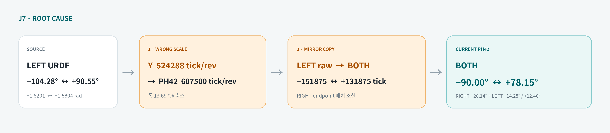
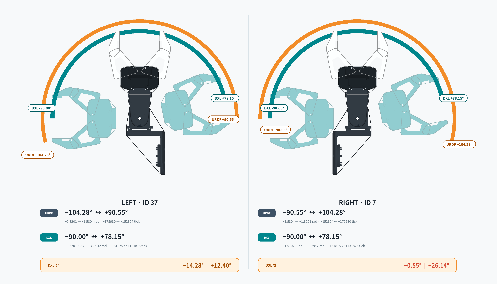

# F2 J7 DYNAMIXEL 위치 제한 설정 오류

## 문서 목적

이 문서는 FFW F2 양팔 J7에서 확인된 DYNAMIXEL 위치 제한 설정 오류만 따로 설명한다.
전체 관절 비교, 변경 시험 절차, 학습 모델 평가 계획은 기존 상세 문서에 남기고, 여기서는
다음 질문에 답하는 데 집중한다.

1. 어떤 값이 잘못됐는가?
2. 왜 잘못된 값이라고 판단했는가?
3. 실제 로봇 명령과 데이터에 어떤 문제가 생기는가?
4. 현재 소스에는 무엇이 적용되어 있고 무엇이 후보로만 남아 있는가?

이 문서는 소스와 기존 비구동 분석 결과를 정리한 것이다. J7 EEPROM limit 변경이나 로봇
구동 검증을 수행했다는 의미가 아니다.

## 결론

F2의 오른팔 J7(ID 7)과 왼팔 J7(ID 37)은 모두 `PH42-020-S300-R`이다. 이 모델의 실제
position 분해능은 `607500 tick/rev`이지만, 기존 J7 limit 값은 Y 계열의
`524288 tick/rev`를 사용해 계산한 값과 거의 정확히 일치한다.

오류는 두 단계로 구성된다.

1. **분해능 오류:** PH42 J7을 Y 계열 분해능으로 환산하여 전체 허용 범위가 좁아졌다.
2. **좌우 복사 오류:** 좌우 J7의 URDF 범위는 서로 mirror 관계인데, 왼팔용 raw limit이
   오른팔에도 동일하게 들어가 오른팔 양의 방향 오차가 특히 커졌다.

현재 production 기준값은 manager 확인 전까지 변경하지 않는다. 실제 PH42 분해능으로
계산한 값은 소스의 주석과 이 문서에 **수정 후보**로만 남긴다.



## 영향을 받는 관절과 설정

| 구분 | 오른팔 J7 | 왼팔 J7 |
| --- | --- | --- |
| ROS joint | `arm_r_joint7` | `arm_l_joint7` |
| DYNAMIXEL ID | `7` | `37` |
| 확인된 모델 | `PH42-020-S300-R` | `PH42-020-S300-R` |
| 모델 번호 | `2000` | `2000` |
| 실제 분해능 | `607500 tick/rev` | `607500 tick/rev` |
| 기존 활성 limit | `[-151875, 131875] tick` | `[-151875, 131875] tick` |

설정 파일은 다음과 같다.

- [기본 F2 ros2_control Xacro](../../ffw_description/ros2_control/ffw_f2_follower/ffw_f2_follower.ros2_control.xacro)
- [Smooth F2 ros2_control Xacro](../../ffw_description/ros2_control/ffw_f2_follower/ffw_f2_follower_smooth.ros2_control.xacro)
- [F2 관절 URDF](../../ffw_description/urdf/common/follower/ffw_f_follower_body.xacro)

## 오류가 확인된 과정

### 1. 실제 J7 모델 확인

실행 로그에서 ID 7과 ID 37이 모두 model number `2000`, model file
`ph42_020_s300.model`로 인식됐다. 따라서 J7을 PH42로 판단한 근거는 외형이나 명칭에
대한 추정이 아니라 실제 DYNAMIXEL ping 결과다.

PH42 model file의 position 환산계수는 다음과 같다.

```text
1 tick = 0.000010342691863670101 rad
1 rev  = 2π rad = 607500 tick
```

따라서 radian과 raw tick의 관계는 다음과 같다.

```text
tick = rad × 607500 / 2π
rad  = tick × 2π / 607500
```

### 2. 기존 값에서 사용된 분해능 역산

기존 양쪽 J7 limit은 다음과 같다.

```text
Min Position Limit = -151875
Max Position Limit =  131875
```

이 값을 실제 PH42 분해능으로 변환하면 다음 범위만 허용한다.

```text
[-151875, 131875] tick
→ [-1.570796327, 1.363942490] rad
→ [-90.00°, +78.15°]
```

반면 같은 값을 Y 계열 분해능 `524288 tick/rev`로 변환하면 다음과 같다.

```text
-151875 × 2π / 524288 ≈ -1.820104 rad
 131875 × 2π / 524288 ≈  1.580420 rad
```

이 범위는 왼팔 J7 URDF 범위 `[-1.8201, 1.5804] rad`와 거의 정확히 일치한다.
기존 limit 전체 폭에서 역산한 값도 약 `524291.672 tick/rev`이며, Y 계열의
`524288 tick/rev`와 약 `0.0007%`밖에 차이가 나지 않는다. 반면 실제 PH42의
`607500 tick/rev`와는 약 `13.7%` 차이가 난다.

따라서 단순히 endpoint 숫자가 우연히 비슷한 것이 아니라, J1~J6에 사용하는 Y 계열
분해능이 J7 계산에도 적용된 흔적으로 판단한다.

### 3. 오른팔과 왼팔의 mirror 관계 손실

J7 URDF 범위는 좌우가 다음처럼 mirror 관계다.

```text
오른팔 J7: [-1.5804,  1.8201] rad
왼팔 J7  : [-1.8201,  1.5804] rad
```

Git 이력상 2025년 4월에는 좌우에 서로 mirror된 raw limit이 존재했다. 그러나 2025년
6월 follower 설정 정리 과정에서 오른팔 J7 값이 왼팔과 동일한 값으로 바뀌었고, F2가
추가될 때도 양쪽에 같은 값이 들어갔다.

```text
오른팔 ID 7 : [-151875, 131875]
왼팔 ID 37  : [-151875, 131875]
```

Drive Mode의 방향 반전은 명령의 회전 방향을 바꾸지만, 서로 다른 Min/Max endpoint를
자동으로 교환하거나 `524288`과 `607500`의 분해능 차이를 보정하지 않는다. 현재 F2
설정에도 이 차이를 보정하는 별도 transmission scale은 없다.

## URDF 범위와 기존 DXL 범위 비교



[J7 URDF·DXL 범위 대화형 시각화 열기](./assets/f2_j7/J7_URDF_DXL_RANGE_VISUALIZATION.html)

HTML 시각화는 GitHub 미리보기에서 실행되지 않을 수 있다. 이 경우 파일을 내려받아
브라우저에서 열면 좌우 범위와 endpoint 차이를 확인할 수 있다.

| 관절과 방향 | URDF endpoint | 기존 DXL endpoint | 부족한 범위 |
| --- | ---: | ---: | ---: |
| 오른팔 J7 lower | `-1.5804 rad` | `-1.570796 rad` | 약 `0.55°` |
| 오른팔 J7 upper | `1.8201 rad` | `1.363942 rad` | 약 `26.14°` |
| 왼팔 J7 lower | `-1.8201 rad` | `-1.570796 rad` | 약 `14.28°` |
| 왼팔 J7 upper | `1.5804 rad` | `1.363942 rad` | 약 `12.40°` |

오른팔만 잘못된 것은 아니다. 양쪽 모두 PH42 분해능 불일치로 URDF보다 DXL 범위가
좁다. 다만 좌우 복사 오류까지 겹친 오른팔 upper의 차이가 약 `26.14°`로 가장 크다.

## 실제로 나타나는 문제

### 상위 제어기와 DYNAMIXEL의 허용 범위가 다름

상위 제어기와 DYNAMIXEL이 서로 다른 제한을 사용하면 다음과 같은 상태가 만들어진다.

```text
Leader 또는 policy target
  → follower URDF 기준으로는 허용
  → controller reference도 target을 유지
  → DYNAMIXEL은 더 좁은 Min/Max Position Limit에 먼저 도달
  → feedback은 endpoint 부근에 머무름
```

이 경우 target과 controller reference는 계속 움직이라고 요구하지만, 실제 J7 feedback은
DXL endpoint에서 plateau를 형성할 수 있다. 따라서 다음 현상이 발생할 수 있다.

- J7 reference와 feedback 사이에 지속적인 추종 오차가 생김
- J7만 목표 각도에 도달하지 못해 손목 방향과 end-effector pose가 달라짐
- 다른 관절이나 작업자가 부족한 J7 동작을 보상함
- 수집 action에는 도달할 수 없는 목표가 반복적으로 기록됨
- 정책이 실제 state 변화 없이 같은 방향의 command를 계속 출력함

### F2 초기 자세와 직접 충돌

F2 초기 자세 설정의 오른팔 J7 `step1`은 `1.8201 rad`를 요구한다.

```text
요청한 오른팔 J7 = 1.8201 rad
기존 DXL hard max = 1.363942 rad
차이              = 0.456158 rad ≈ 26.14°
```

즉, 상위 초기 자세 설정 자체가 기존 오른팔 J7 DXL limit 밖의 값을 요구한다. 초기 자세
파일이 잘못됐다고 단정하는 것이 아니라, URDF·초기 자세와 DXL limit이 서로 같은 범위를
전제로 하지 않는다는 것이 문제다.

### 기존 수집 데이터에서의 흔적

Task 700013 파생 데이터 100 episode, 129654 frame을 읽기 전용으로 분석했을 때 다음과
같은 J7 포화가 확인됐다.

- `arm_l_joint7`이 URDF lower `-1.8201 rad`에 기록된 frame: `37506`, 약 `28.93%`
- `arm_r_joint7`이 URDF upper `1.8201 rad`에 기록된 frame: `76309`, 약 `58.86%`
- 왼쪽 J7의 episode별 최장 연속 clamp 구간 중앙값: 약 `10.0초`

이 수치는 J7 command가 제한 경계에 장시간 머물렀음을 보여 준다. 다만 이 분석만으로
특정 task 실패가 전부 J7 설정 오류 때문에 발생했다고 단정할 수는 없다. 카메라 구도,
데이터 동기화, 정책 출력 및 다른 controller 조건은 별도로 평가해야 한다.

## 수학적으로 계산한 수정 후보

PH42의 실제 `607500 tick/rev`를 사용해 좌우 URDF 범위를 최소 1 tick 바깥에서
포함시키면 다음 후보를 얻는다.

| 관절 | 후보 Min | 후보 Max | 환산 범위 |
| --- | ---: | ---: | --- |
| 오른팔 J7, ID 7 | `-152804` | `175980` | `[-1.580405, 1.820107] rad` |
| 왼팔 J7, ID 37 | `-175980` | `152804` | `[-1.820107, 1.580405] rad` |

이 값은 **수학적으로 URDF를 포함하는 후보**이지, production 적용이 승인된 값이 아니다.
기구 stopper, 손목 카메라, 케이블, gripper 및 주변 구조물과의 간섭을 확인하지 않고
EEPROM limit을 넓히면 기존 hard limit이 막고 있던 영역으로 실제 관절이 진입할 수 있다.

## 현재 소스 상태

Manager 확인 전까지 활성값은 기존 F2 설정으로 유지한다.

```xml
<!-- 오른팔 ID 7: 현재 활성값 -->
<param name="Max Position Limit">131875</param>
<param name="Min Position Limit">-151875</param>

<!-- 왼팔 ID 37: 현재 활성값 -->
<param name="Max Position Limit">131875</param>
<param name="Min Position Limit">-151875</param>
```

기본 F2 Xacro에는 PH42 계산 결과를 다음처럼 주석 후보로만 남긴다.

```xml
<!-- 오른팔 ID 7: 미승인 후보 -->
<!--
<param name="Max Position Limit">175980</param>
<param name="Min Position Limit">-152804</param>
-->

<!-- 왼팔 ID 37: 미승인 후보 -->
<!--
<param name="Max Position Limit">152804</param>
<param name="Min Position Limit">-175980</param>
-->
```

이 주석은 수정 적용이 아니라, 검토할 숫자와 계산 근거를 소스 가까이에 보존하기 위한
것이다. 현재 실행 중인 DYNAMIXEL EEPROM을 변경하거나 새 후보로 powered test를 수행한
상태가 아니다.

## Manager 확인이 필요한 사항

다음 항목을 확인하기 전에는 후보값을 활성화하지 않는다.

- 설치된 ID 7·37의 모델과 EEPROM Min/Max/Homing Offset read-back
- torque-off 상태의 실제 기구 가동 범위
- 손목 카메라, 케이블, gripper, cover 및 반대쪽 팔과의 간섭
- endpoint 접근 시 current와 Hardware Error Status
- 기본 Xacro와 smooth Xacro를 같은 기준으로 변경할지 여부
- 기존 dataset/checkpoint를 유지할지, 새 범위에서 데이터를 다시 수집할지 여부

## 짧게 설명하면

> F2 J7은 실제로 PH42 모터라서 한 바퀴가 607500 tick인데, 기존 limit은 다른 팔
> 관절에 사용하는 Y 계열의 524288 tick 기준으로 계산돼 있었습니다. 여기에 왼팔용
> endpoint가 오른팔에도 복사되어 오른팔은 URDF가 허용하는 양의 방향보다 약 26도 먼저
> DXL limit에 도달합니다. PH42 기준 후보값은 계산했지만, 기구와 케이블 안전 확인을 받지
> 않았기 때문에 기존값은 유지하고 후보만 주석과 문서에 남겼습니다.
